# Manual do Usuário — Painel de Squads para Jira

Este manual explica, tela por tela, o que cada número significa, como ele é calculado e quando vale agir. Todas as capturas foram feitas no **modo demonstração**, com dados fictícios gerados para a ocasião (veja a [seção 8](#8-como-ler-os-dados-do-demonstração)). Nenhum número das imagens vem de um Jira real.

> Convenções: datas em dd/mm/aaaa, números em formato brasileiro (1.234,5), "d" = dias corridos, "h" = horas. As fórmulas descritas aqui foram conferidas no código (`analytics.py`, `reports.py`, `metrics/*.py`, `distribution/engine.py`). Onde algo é **heurístico** (peso escolhido por convenção, sem base normativa), o texto diz isso.

## Sumário

1. [O que é e como navegar](#1-o-que-é-e-como-navegar)
2. [Filtros e períodos](#2-filtros-e-períodos)
3. [Telas, uma a uma](#3-telas-uma-a-uma)
   - [3.1 Visão geral](#31-visão-geral) · [3.2 Meu painel](#32-meu-painel) · [3.3 Abertas](#33-abertas) · [3.4 Épicos](#34-épicos) · [3.5 Negligenciadas](#35-negligenciadas) · [3.6 Riscos](#36-riscos) · [3.7 Previsão](#37-previsão)
   - [3.8 Fechadas](#38-fechadas) · [3.9 Negativas](#39-negativas) · [3.10 Tempo em status](#310-tempo-em-status)
   - [3.11 Carga por pessoa](#311-carga-por-pessoa) · [3.12 Capacidade e ausências](#312-capacidade-e-ausências) · [3.13 Gargalos e fluxo](#313-gargalos-e-fluxo)
   - [3.14 Qualidade dos dados](#314-qualidade-dos-dados) · [3.15 Auditoria](#315-auditoria) · [3.16 Sincronização](#316-sincronização)
4. [Metas e prazos (em detalhe)](#4-metas-e-prazos)
5. [Checklist × Review (em detalhe)](#5-checklist--review)
6. [Integridade (em detalhe)](#6-integridade)
7. [Distribuição e Rebalanceamento (em detalhe)](#7-distribuição-e-rebalanceamento)
8. [Como ler os dados do demonstração](#8-como-ler-os-dados-do-demonstração)
9. [Glossário](#9-glossário)
10. [Perguntas frequentes e solução de problemas](#10-perguntas-frequentes-e-solução-de-problemas)

---

## 1. O que é e como navegar

O painel lê o Jira (Cloud ou Data Center), guarda o histórico num banco próprio e mostra, por **squad, projeto e pessoa**: o que está aberto, o que está parado, o que foi fechado e como, previsões, capacidade (com férias, licenças e feriados) e sugestões de distribuição de trabalho que um gerente aprova.

Princípio de uso: **métricas de fluxo para equipes, não para ranking de pessoas.** Não existe nota nem ranking por pessoa; tabelas de pessoas saem em ordem alfabética de propósito.

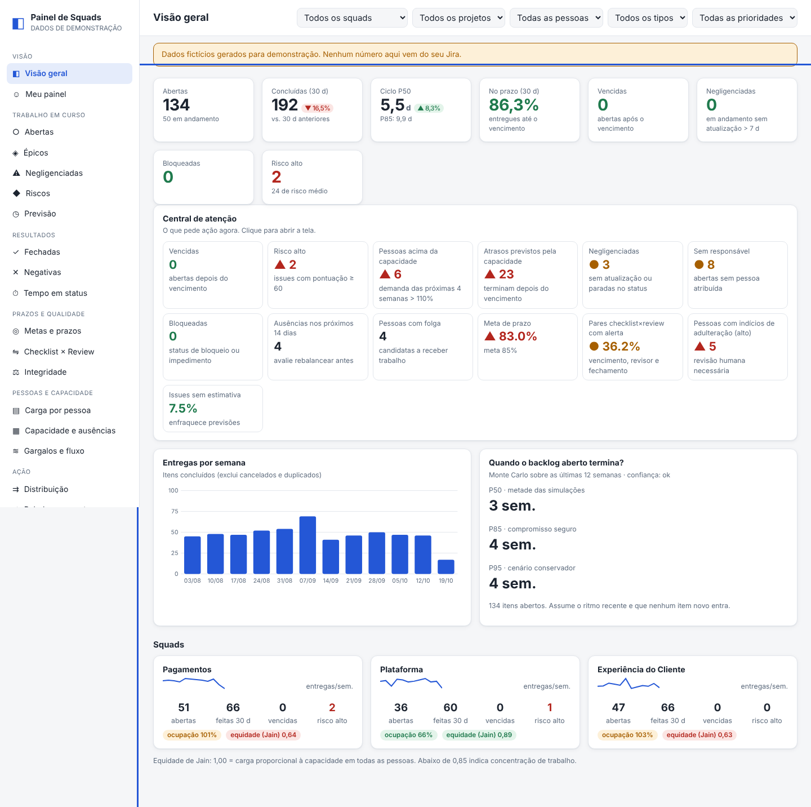

### 1.1 Menu lateral

O menu à esquerda agrupa as telas. O grupo "Prazos e qualidade" reúne Metas e prazos, Checklist × Review e Integridade.

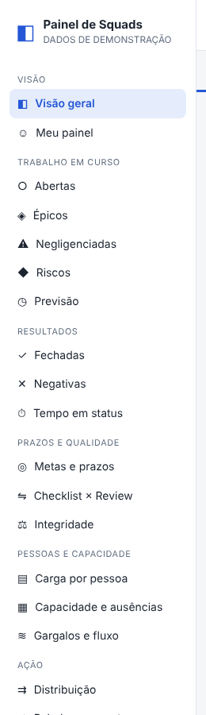

| Grupo | Telas | Pergunta que responde |
|---|---|---|
| Visão | Visão geral, Meu painel | Como estão os squads? Como está a fila de uma pessoa? |
| Trabalho em curso | Abertas, Épicos, Negligenciadas, Riscos, Previsão | O que está aberto, parado, em risco e quando termina? |
| Resultados | Fechadas, Negativas, Tempo em status | O que foi entregue, o que deu errado e onde o tempo é gasto? |
| Prazos e qualidade | Metas e prazos, Checklist × Review, Integridade | Estamos cumprindo prazos? A revisão funciona? Há indícios de manipulação de resultados? |
| Pessoas e capacidade | Carga por pessoa, Capacidade e ausências, Gargalos e fluxo | Quem está sobrecarregado, quem tem folga, onde o fluxo trava? |
| Ação | Distribuição, Rebalanceamento | A quem entregar o trabalho novo; o que mover de quem está sobrecarregado |
| Governança | Qualidade dos dados, Auditoria, Sincronização | Os dados sustentam as previsões? Quem decidiu o quê? A coleta está em dia? |

### 1.2 Barra de filtros

No topo de cada tela há uma barra com cinco seletores (Squad, Projeto, Pessoa, Tipo, Prioridade) e, nas telas que usam período, dois campos de data (De, Até). Detalhes na [seção 2](#2-filtros-e-períodos).

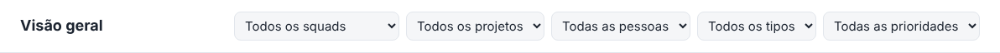

### 1.3 URL com filtros (links compartilháveis)

Todos os filtros ficam no endereço, depois do `#`. Copie a URL e envie: quem abrir verá a mesma tela com os mesmos filtros. Exemplos:

```
#/aberta?squad=pagamentos
#/fechadas?squad=pagamentos&date_from=2026-09-22&date_to=2026-10-22
#/metas?date_from=2026-09-01&date_to=2026-09-30&granularity=day
#/meu?person=3
```

Ao trocar de tela pelo menu, os filtros ativos são mantidos. As datas na URL usam o formato ISO (aaaa-mm-dd); na tela aparecem no formato do seu navegador (em navegador configurado em português, dd/mm/aaaa).

### 1.4 Tema claro e escuro

O botão **Tema**, no rodapé do menu, alterna entre claro e escuro. A escolha fica gravada no navegador. Gráficos, cores e símbolos funcionam nos dois temas.

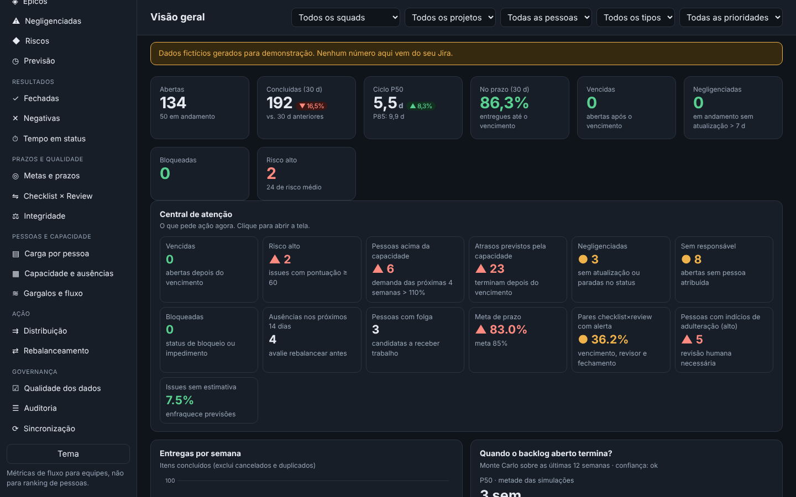

### 1.5 Celular

Em telas estreitas o menu vira um botão ☰ no topo, e os cartões se empilham.

| Visão geral | Menu aberto | Tabela de abertas |
|---|---|---|
| 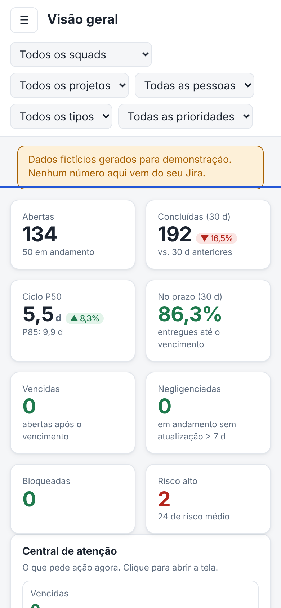 | 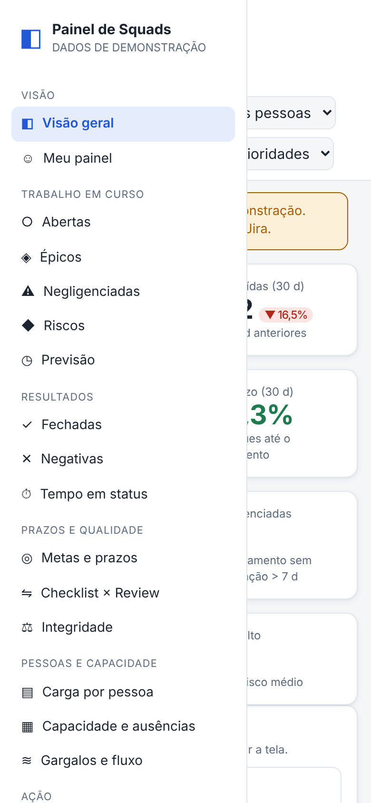 | 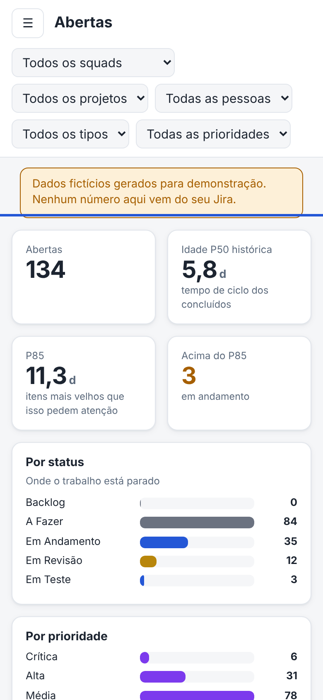 |

### 1.6 Exportar CSV

Três listas têm link **exportar CSV** no cabeçalho do cartão: *Issues abertas* (tela Abertas), *Issues concluídas* (tela Fechadas) e, pela API, *riscos* (`/api/export/risks.csv`). O arquivo respeita os filtros ativos (squad, projeto, pessoa, tipo, prioridade, e período no caso de fechadas), usa `;` como separador e vírgula decimal, e traz na primeira linha um comentário `# filtros: ...` registrando quais filtros estavam ativos.

### 1.7 Gaveta de detalhe da issue

Em qualquer tabela de issues (Abertas, Negligenciadas, Riscos, Fechadas, Negativas, Distribuição), **clique numa linha** (não na chave, que abre o Jira) para abrir a gaveta à direita. Feche com ✕ ou `Esc`.

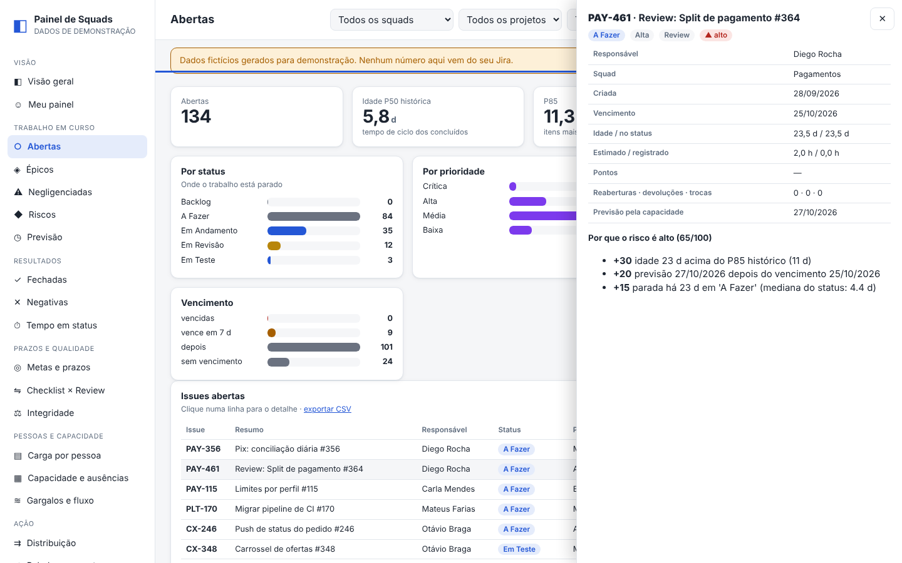

A gaveta mostra: status, prioridade, tipo e nível de risco; responsável e squad; datas de criação, vencimento e resolução; idade e tempo no status atual; estimado × registrado; pontos; contagem de reaberturas, devoluções e trocas de responsável; previsão pela capacidade; o gráfico **Tempo por status** (dias em cada etapa) e, se houver risco, a lista **"Por que o risco é ..."** com os pontos de cada fator.

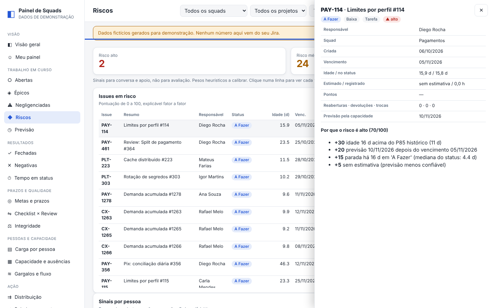

### 1.7.1 Ver as tasks de qualquer card (detalhamento)

Quase tudo que mostra um número é clicável: cartões de indicadores (os que mostram "▸ ver tasks"), barras e colunas dos gráficos, células dos mapas de calor, números dentro das tabelas (sublinhados com pontilhado) e itens da Central de atenção. Ao clicar, abre uma janela com **as tasks que compõem aquele número**, calculadas com os mesmos filtros e o mesmo período da tela.

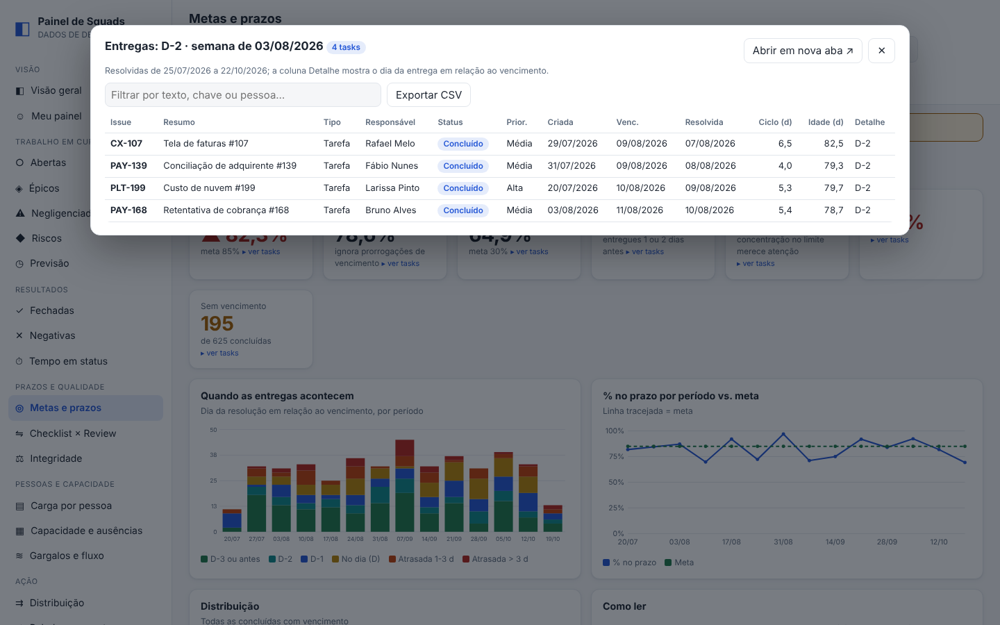

Na janela:

- **Filtrar por texto** (chave, resumo, pessoa, status) e **ordenar** clicando no título das colunas.
- **Clicar numa linha** abre a gaveta de detalhe da issue (histórico de status, fatores de risco).
- **Abrir em nova aba** leva a uma página própria com a mesma lista e os mesmos filtros (`#/tarefas?kind=...`), que pode ser compartilhada por link.
- **Exportar CSV** baixa a lista (com o texto da coluna "Detalhe").
- A coluna **Detalhe** explica por que a task entrou: dia da entrega em relação ao vencimento (D-2, atrasada…), horas da semana, tempo no status, evidências de integridade, alertas do par checklist × review etc.
- A quantidade de tasks da janela é igual ao número do card; se não for (por exemplo, em "Evidências", que conta evidências e não issues), a descrição explica a diferença.

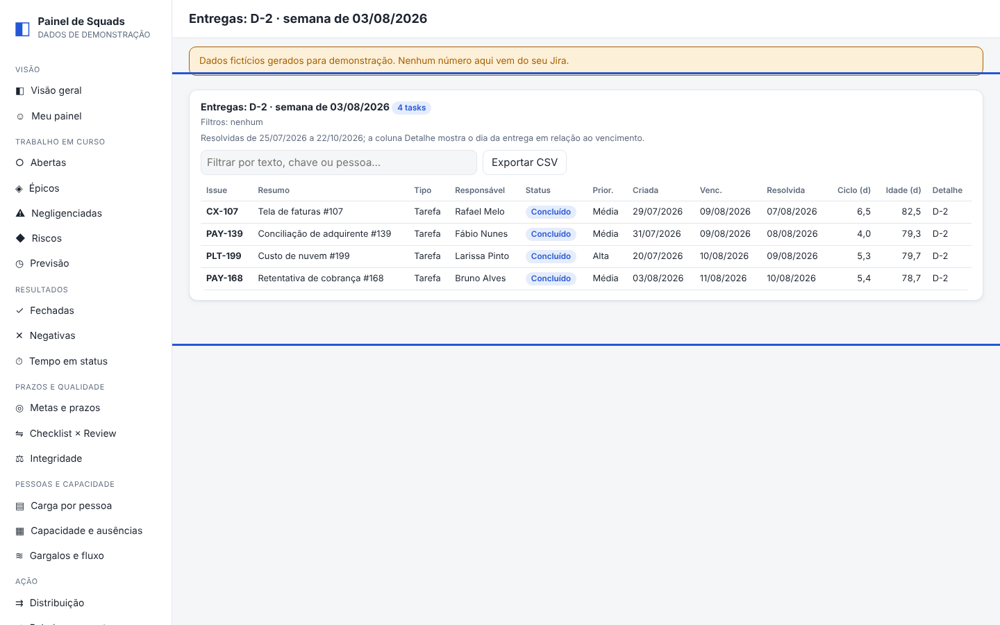

### 1.8 Dados em cache

Os resultados de cada tela ficam em cache por 60 segundos (configurável). Se você acabou de sincronizar ou de decidir uma sugestão, o cache é invalidado automaticamente; fora isso, a diferença pode levar até um minuto para aparecer.

---

## 2. Filtros e períodos

### 2.1 Os filtros

| Filtro | O que faz | Observação |
|---|---|---|
| **Squad** | Restringe às issues do squad e, nas telas de capacidade, às pessoas membros dele (com a alocação do squad). | Cada squad tem projetos Jira próprios. |
| **Projeto** | Restringe às issues do projeto Jira (ex.: PAY). | Lista só projetos existentes nos dados. |
| **Pessoa** | Restringe às issues **atribuídas** à pessoa. | Gerentes não aparecem na lista. |
| **Tipo** | Restringe ao tipo de issue (Bug, Tarefa, História, Checklist, Review...). | |
| **Prioridade** | Restringe à prioridade. | |
| **De / Até** | Período, pela **data de resolução** da issue. | Só aparece nas telas listadas abaixo. |
| **Granularidade** | Dia, Semana ou Mês. | **Só a tela Metas e prazos**, com botões no topo da tela. |

Squad e projeto definem o "universo" de issues; pessoa, tipo e prioridade refinam a lista. Os filtros se **combinam por E**: `squad=pagamentos` + `type=Bug` + `priority=Alta` mostra só bugs de prioridade alta do squad Pagamentos.

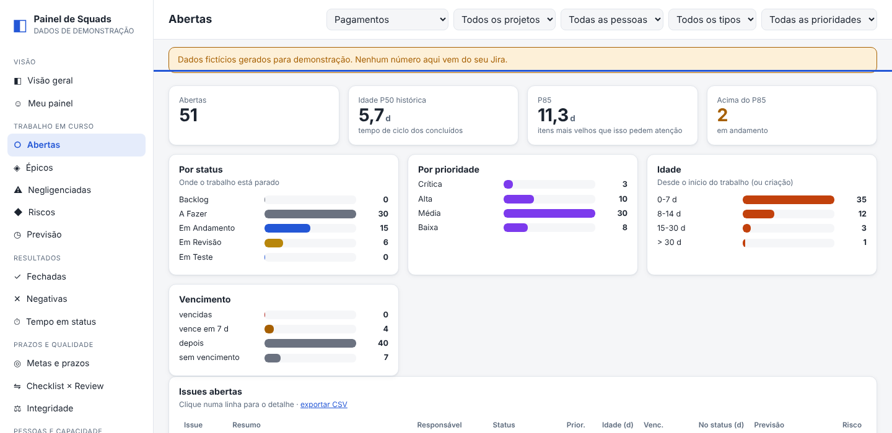

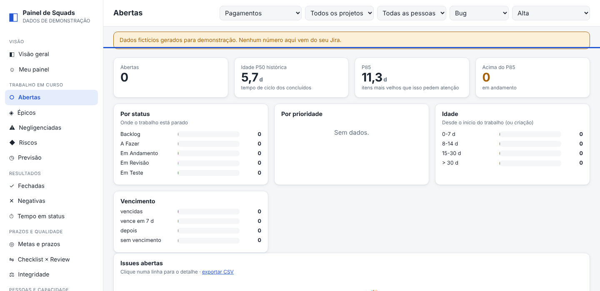

### 2.2 Períodos padrão (quando você não escolhe datas)

| Tela | Período padrão |
|---|---|
| Visão geral | Cartões "30 d": últimos 30 dias (comparados aos 30 anteriores); não usa o filtro de datas |
| Fechadas | Últimos 30 dias (hoje e os 29 dias anteriores) |
| Negativas | Últimos 90 dias (hoje e os 89 anteriores) |
| Tempo em status | Últimos 90 dias |
| Metas e prazos | Últimos 90 dias |
| Checklist × Review | Últimos 90 dias |
| Integridade | Últimos 90 dias |

Os campos **De** e **Até** só aparecem nas seis telas acima: **Fechadas, Negativas, Tempo em status, Metas e prazos, Checklist × Review, Integridade**. O período aplica-se à **data de resolução**. Telas de "trabalho em curso" (abertas, riscos, previsão, capacidade etc.) mostram a **situação de hoje** e ignoram datas, mesmo que você deixe `date_from` na URL.

### 2.3 Quais telas respeitam quais filtros

Conferido no código de cada endpoint. "Sim" = filtra os dados exibidos; "Parcial" = ver nota.

| Tela | Squad | Projeto | Pessoa | Tipo | Prioridade | Datas |
|---|---|---|---|---|---|---|
| Visão geral | Sim | Sim | Sim | Sim | Sim | Não (últimos 30 dias fixos) |
| Meu painel | Sim | Sim | **Obrigatório** | Sim | Sim | Não |
| Abertas | Sim | Sim | Sim | Sim | Sim | Não |
| Épicos | Sim | Sim | (oculto) | (oculto) | (oculto) | Não |
| Negligenciadas | Sim | Sim | Sim | Sim | Sim | Não |
| Riscos | Sim | Sim | Sim | Sim | Sim | Não |
| Previsão | Sim | Sim | Sim | Sim | Sim | Não |
| Fechadas | Sim | Sim | Sim | Sim | Sim | **Sim** |
| Negativas | Sim | Sim | Sim | Sim | Sim | **Sim** |
| Tempo em status | Sim | Sim | Sim | Sim | Sim | **Sim** |
| Metas e prazos | Sim | Sim | Sim | Sim | Sim | **Sim** (+ granularidade) |
| Checklist × Review | Sim | Sim | Sim (pelo checklist) | Sim (pelo checklist) | Sim (pelo checklist) | **Sim** |
| Integridade | Sim | Sim | Sim | Sim | Sim | **Sim** |
| Carga por pessoa | Sim | Sim | Sim | (oculto) | (oculto) | Não |
| Capacidade e ausências | Sim | Sim | Sim | (oculto) | (oculto) | Não |
| Gargalos e fluxo | Sim | Sim | Sim | (oculto) | (oculto) | Não (fixo em 60 dias) |
| Distribuição | **Só squad** | Não | Não | Não | Não | Não |
| Rebalanceamento | **Só squad** | Não | Não | Não | Não | Não |
| Qualidade dos dados | Sim | Sim | Sim | Sim | Sim | Não |
| Auditoria / Sincronização | Sem filtros | | | | | |

Notas:

- **Filtros ocultos**: em cada tela, a barra mostra apenas os filtros que alteram os números. Em Épicos, Carga por pessoa, Capacidade e Gargalos, tipo e prioridade ficam ocultos, porque a capacidade de uma pessoa não depende do tipo da tarefa e a carga considera todas as issues abertas dela. Em Distribuição e Rebalanceamento só o squad aparece.
- **Visão geral**: os cartões do rodapé "Squads" respeitam squad, projeto, pessoa, tipo e prioridade.
- **Distribuição**: a tabela de pendentes e a lista de sugestões aguardando decisão respeitam o squad escolhido.
- **Datas e fuso**: "no prazo", D-1/D-2 e "dia do vencimento" usam o dia civil no fuso configurado em `JIRADASH_TZ` (padrão America/Sao_Paulo) em todas as telas.

### 2.4 Exemplos passo a passo

**Exemplo 1 — Ver só o squad Pagamentos nos últimos 30 dias.**
1. Abra **Fechadas**.
2. No seletor *Squad*, escolha **Pagamentos**.
3. Em **De**, digite 22/09/2026; em **Até**, 22/10/2026 (ou use a URL `#/fechadas?squad=pagamentos&date_from=2026-09-22&date_to=2026-10-22`).
4. Troque de tela pelo menu (por exemplo para **Metas e prazos** ou **Negativas**): squad e datas continuam valendo.

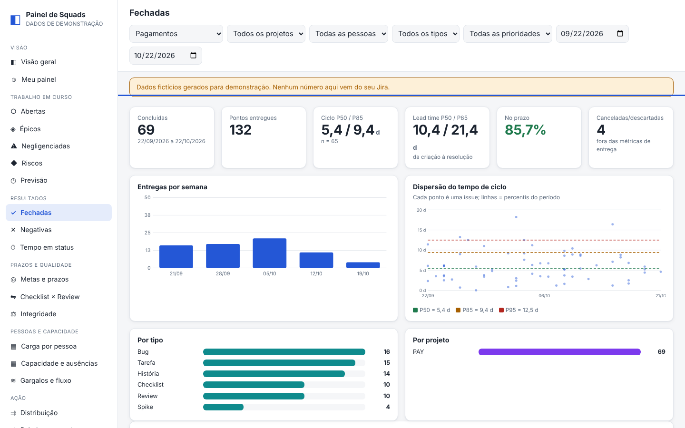

**Exemplo 2 — Ver uma pessoa.**
1. Escolha a pessoa no seletor *Pessoa* de qualquer tela (ex.: Fábio Nunes) para ver só as issues atribuídas a ela.
2. Para uma visão individual completa (fila, ocupação, riscos, ausências) use **Meu painel**: `#/meu?person=3`. Sem pessoa escolhida a tela só mostra um lembrete para escolher.
3. Lembre-se de usar os números para conversar sobre fluxo e apoio, não para avaliar.

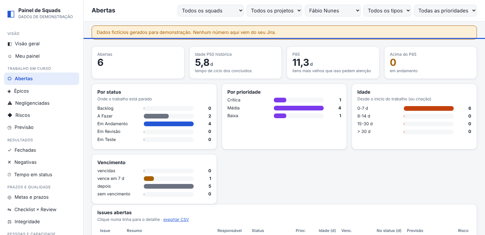

**Exemplo 3 — Comparar um mês.** Em **Metas e prazos**, ajuste De/Até para 01/09/2026 e 30/09/2026 e anote os cartões; depois ajuste para 01/10/2026 e 22/10/2026 e compare. Ou use o botão **Mês** (granularidade) com o período de três meses para ver a série mês a mês no gráfico "% no prazo por período vs. meta".

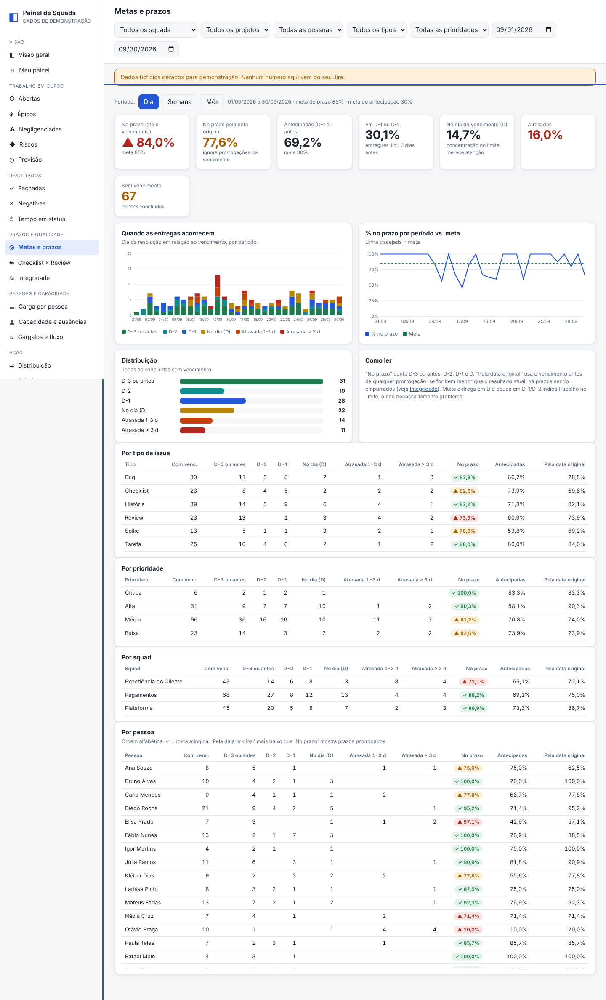

**Exemplo 4 — Granularidade.** Os botões **Dia / Semana / Mês** na tela Metas e prazos mudam só os dois gráficos de série (entregas por período e % no prazo por período). Os cartões e tabelas não mudam. Na URL: `granularity=day|week|month`.

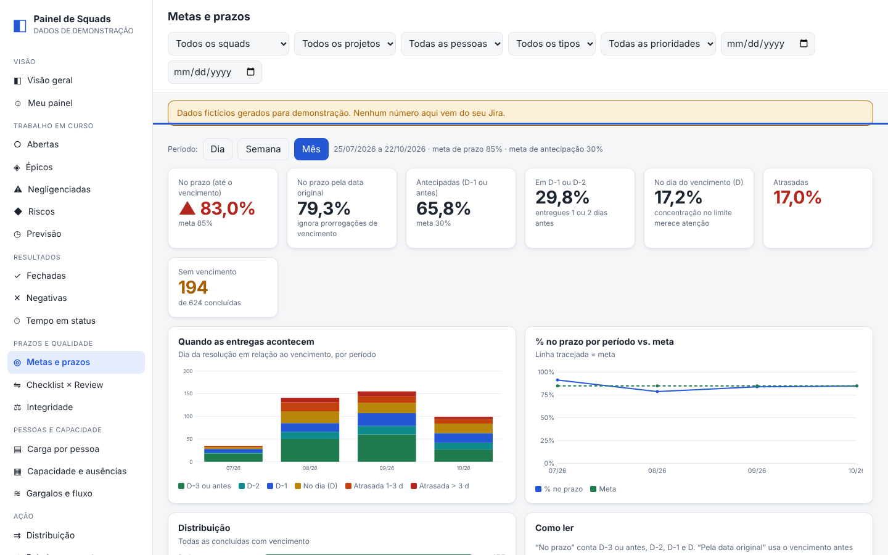

**Exemplo 5 — Squad + Metas.** `#/metas?squad=pagamentos` mostra a meta de prazo só do squad.

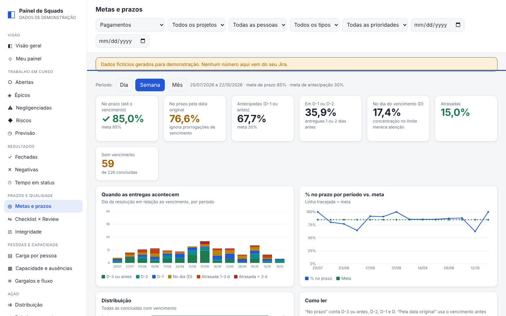

---

## 3. Telas, uma a uma

Legenda de cores e símbolos usada em todo o painel (a cor nunca é o único sinal):

| Símbolo | Significado |
|---|---|
| **▲** vermelho | Atenção alta / acima do limite / meta não atingida / gargalo |
| **●** laranja | Atenção média / zona de alerta |
| **✓** verde | Dentro do esperado / meta atingida / baixo |
| ■ cinza | Sem variação |
| ▲ / ▼ ao lado de uma porcentagem em cartão | Variação em relação ao período anterior (ver 3.1: no "Ciclo P50" a seta é invertida) |
| "—" | Sem dados ou sem amostra suficiente |

Em cartões numéricos (KPI) a cor do valor é: verde = bom, laranja = alerta, vermelho = problema.

### 3.1 Visão geral

Painel de entrada: números-chave, central de atenção, entregas semanais, previsão do backlog e um cartão por squad.


| Card | O que mostra | Como é calculado | Como interpretar | Quando agir |
|---|---|---|---|---|
| **Abertas** | Issues não concluídas; abaixo, quantas "em andamento" | Abertas = categoria diferente de "concluída". Em andamento = categoria ativa, espera/revisão ou bloqueada | Volume de trabalho aberto | Crescimento contínuo sem aumento de entregas indica acúmulo |
| **Concluídas (30 d)** | Entregas nos últimos 30 dias, com variação % contra os 30 dias anteriores | Conta issues resolvidas com resolução positiva (exclui canceladas/duplicadas/"não será feito") | ▲ verde = mais entregas que antes; ▼ vermelho = menos | Queda forte sem explicação (férias, feriados) pede conversa sobre bloqueios |
| **Ciclo P50** | Mediana do tempo de ciclo (dias) nos últimos 30 dias; rodapé mostra o P85 | Ciclo = da 1ª entrada em status ativo/espera/bloqueado até a resolução. P50 = mediana, P85 = 85º percentil | **Atenção:** a variação é mostrada com sinal invertido: ▲ verde = ciclo **menor** (melhor), ▼ vermelho = ciclo **maior** | Ciclo subindo = trabalho demorando mais |
| **No prazo (30 d)** | % das entregues dos últimos 30 dias que foram concluídas até o vencimento | Entre as concluídas com vencimento: resolvidas em data ≤ vencimento ÷ total. Issues sem vencimento ficam de fora | Verde se ≥ 80%, laranja se < 80% | Abaixo da meta do squad: ver Metas e prazos |
| **Vencidas** | Abertas com vencimento anterior a hoje | Conta issues abertas com `due < hoje` | Vermelho se > 0 | Renegociar prazo ou priorizar |
| **Negligenciadas** | Em andamento sem atualização há mais de 7 dias | Categoria ativa/espera/bloqueada e `atualizada` há > 7 dias | Laranja se > 0. **Não inclui** "paradas no status" (que a Central de atenção soma) | Cobrar atualização ou destravar |
| **Bloqueadas** | Issues em status de bloqueio ou com impedimento sinalizado (flag) | Categoria "bloqueada" ou flag ligada no Jira | Laranja se > 0 | Remover o impedimento |
| **Risco alto** | Issues com score de risco ≥ 60; rodapé: quantas de risco médio (30 a 59) | Ver [3.6 Riscos](#36-riscos) | Vermelho se > 0 | Abrir a tela Riscos |
| **Central de atenção** | Lista de 13 indicadores que pedem ação agora; cada um é um link para a tela de destino | Reaproveita cálculos das outras telas (tabela abaixo) | ▲ vermelho = problema; ● laranja = alerta; sem símbolo = informativo; zero/ok = verde | Clique no item e trate na tela de destino |
| **Entregas por semana** | Colunas: itens concluídos por semana (segunda a domingo), últimas 12 semanas | Resolvidas com resolução positiva, agrupadas por semana | Ritmo do time; a semana corrente costuma estar incompleta | Queda persistente ou oscilação grande |
| **Quando o backlog aberto termina?** | Semanas até zerar o backlog aberto (P50, P85, P95) e confiança | Simulação Monte Carlo (10.000 tentativas): sorteia com reposição o throughput semanal das últimas 12 semanas até acumular o nº de itens abertos. **Assume ritmo recente e que nenhum item novo entra.** Confiança "baixa" com menos de 8 semanas de histórico | P50 = metade das simulações; P85 = compromisso seguro; P95 = conservador | Use P85 para comprometer datas; baixa confiança = tratar como ordem de grandeza |
| **Squads** (um card por squad) | Mini-gráfico de entregas por semana, abertas, feitas em 30 d, vencidas, risco alto, pílulas de **ocupação** e **equidade (Jain)** | Ocupação média = média das ocupações (demanda 4 sem. ÷ capacidade 4 sem.) das pessoas do squad. Jain: ver glossário. Clique abre Abertas filtrada pelo squad | Ocupação: verde ≤ 85%, laranja 85–110%, vermelho > 110%. Jain: verde ≥ 0,85, laranja 0,70–0,85, vermelho < 0,70 | Jain baixo = trabalho concentrado em poucos |

**Itens da Central de atenção** (cada um leva a uma tela):

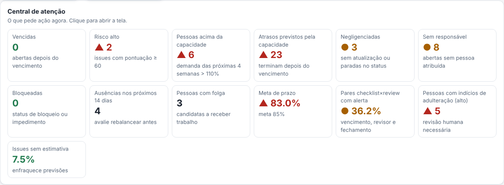

| Item | Valor | Cor | Destino |
|---|---|---|---|
| Vencidas | Nº de abertas vencidas | ▲ vermelho se > 0 | Abertas |
| Risco alto | Issues com score ≥ 60 | ▲ vermelho | Riscos |
| Pessoas acima da capacidade | Pessoas com demanda das próximas 4 semanas > 110% da capacidade | ▲ vermelho | Capacidade |
| Atrasos previstos pela capacidade | Issues cuja previsão (pela fila e horas líquidas) passa do vencimento | ▲ vermelho | Capacidade |
| Negligenciadas | "Sem atualização" **mais** "paradas no status" (pode contar a mesma issue duas vezes) | ● laranja | Negligenciadas |
| Sem responsável | Abertas sem pessoa atribuída | ● laranja | Negligenciadas |
| Bloqueadas | Bloqueadas/com impedimento | ● laranja | Negligenciadas |
| Ausências nos próximos 14 dias | Ausências que começam em até 14 dias | informativo | Capacidade |
| Pessoas com folga | Ocupação < 50% nas 4 semanas (e capacidade > 0) | informativo | Distribuição |
| Meta de prazo | % no prazo da tela Metas (90 dias) e a meta | ▲ vermelho se abaixo da meta, verde se atingida | Metas e prazos |
| Pares checklist×review com alerta | % de pares com ao menos um alerta | ● laranja | Checklist × Review |
| Pessoas com indícios de adulteração (alto) | Nº de pessoas no nível "alto" da Integridade | ▲ vermelho | Integridade |
| Issues sem estimativa | % das abertas sem estimativa nem pontos | ● se > 20% | Qualidade dos dados |

> Atenção: os números da Central usam períodos próprios (Meta de prazo e Checklist×Review: últimos 90 dias) e podem diferir dos cartões de 30 dias ao lado. A Central ignora o filtro de datas.

### 3.2 Meu painel

Visão individual da fila de uma pessoa. Exige o filtro **Pessoa** (ex.: `#/meu?person=3`).

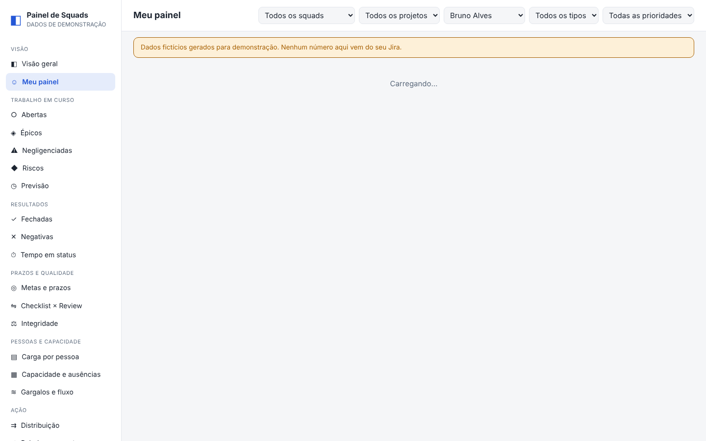

| Card | O que mostra | Como é calculado | Interpretação | Quando agir |
|---|---|---|---|---|
| **Minhas abertas** | Issues abertas atribuídas à pessoa | Contagem | Tamanho da fila | — |
| **Ocupação 4 semanas** | Demanda ÷ capacidade das próximas 4 semanas | Ver [3.11](#311-carga-por-pessoa) | Verde ≤ 85%, laranja até 110%, vermelho acima | > 110%: avisar o gerente |
| **Em risco** | Quantas issues da pessoa têm score de risco ≥ 30 | Ver [3.6](#36-riscos) | Laranja se > 0 | Abrir as de maior risco |
| **Ausências futuras** | Quantas ausências planejadas ainda não terminaram | Ausências com fim ≥ hoje | — | Replanejar a fila antes da ausência |
| **Minha fila** | Tabela das abertas, da mais velha à mais nova, com previsão e risco | Linha clicável (gaveta) | Idade, vencimento, previsão pela capacidade e risco | Tratar primeiro risco alto e vencidas |

### 3.3 Abertas

Retrato do trabalho em aberto hoje.

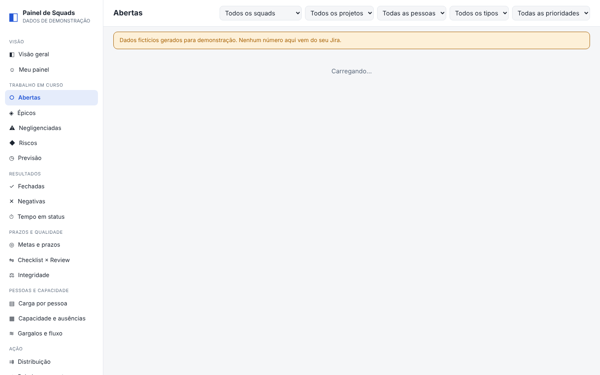

| Card | O que mostra | Como é calculado | Interpretação | Quando agir |
|---|---|---|---|---|
| **Abertas** | Total de issues abertas | Contagem | — | — |
| **Idade P50 histórica** | Mediana do tempo de ciclo dos concluídos | Ciclo de issues concluídas (com resolução positiva) nas últimas 16 semanas do squad/projeto (sem filtro de pessoa/tipo/prioridade) | Referência do "normal" | — |
| **P85** | 85º percentil do mesmo histórico | idem | Itens em andamento mais velhos que isso pedem atenção | — |
| **Acima do P85** | Issues em andamento com idade maior que o P85 | Idade = agora − 1ª entrada em status ativo (ou criação se nunca iniciou); conta só as que não estão em "a fazer" | Laranja | Revisar cada uma: pode estar travada |
| **Por status** | Quantas issues em cada status do fluxo | Contagem por status, na ordem do fluxo. Azul = ativo, roxo = espera/revisão, vermelho = bloqueado, cinza = a fazer | Onde o trabalho está parado | Status inflado à direita do fluxo = gargalo |
| **Por prioridade** | Distribuição por prioridade | Contagem | Excesso de "Crítica" perde significado | — |
| **Idade** | Faixas 0-7 d, 8-14 d, 15-30 d, > 30 d | Idade como acima | Cauda longa = trabalho esquecido | Tratar > 30 d |
| **Vencimento** | Vencidas, vence em 7 d, depois, sem vencimento | Compara `due` com hoje | Vencidas em vermelho; "vence em 7 d" em laranja | Renegociar prazos |
| **Issues abertas** | Tabela ordenável: issue, resumo, responsável, status, prioridade, idade, vencimento, dias no status, previsão, risco | Ordenada por idade decrescente; clique no cabeçalho para ordenar; linha abre a gaveta; **exportar CSV** | Risco: ▲ alto, ● médio, ✓ baixo e a pontuação | Comece pelas mais antigas e de risco alto |

### 3.4 Épicos

Progresso por épico, com itens abertos, o mais antigo e uma previsão grosseira.

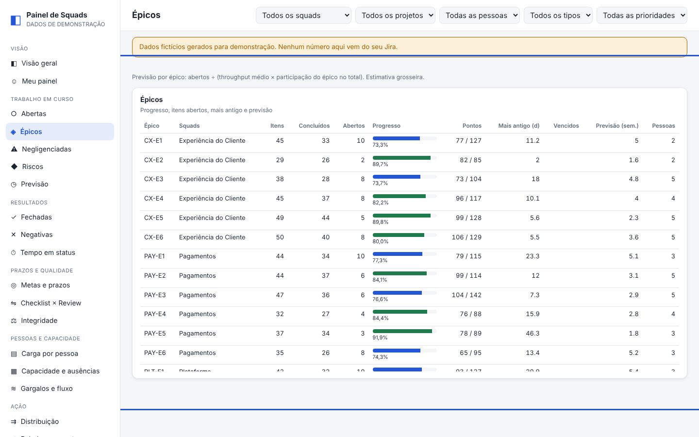

| Card | O que mostra | Como é calculado | Interpretação | Quando agir |
|---|---|---|---|---|
| **Épicos** (tabela) | Épico, squads, itens, concluídos, abertos, progresso, pontos (feitos/total), mais antigo (d), vencidos, previsão (semanas), pessoas | Itens = todas as issues ligadas ao épico (exclui o tipo Review). Concluídos = concluídos com resolução positiva. Progresso = concluídos ÷ itens. Mais antigo = maior idade entre as abertas. Vencidos = abertas com vencimento passado. **Previsão (sem.) = abertos ÷ (throughput médio semanal × participação do épico no total de issues)**, limitada a 52 | Barra verde ≥ 80%, azul ≥ 50%, laranja abaixo. A previsão é uma **estimativa grosseira** (a própria tela avisa) | "Mais antigo" muito alto, vencidos > 0 ou previsão longa pedem revisão de escopo |

Observações: canceladas contam nos itens mas não em concluídos (reduzem o progresso). Esta tela ignora os filtros de pessoa, tipo e prioridade.

### 3.5 Negligenciadas

Seis listas de trabalho que pode estar esquecido, em abas.

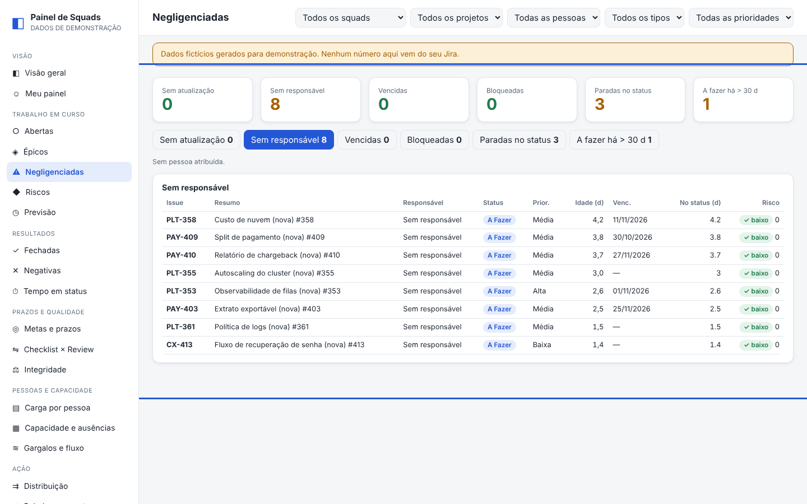

| Card (cartão e aba) | O que mostra | Como é calculado | Quando agir |
|---|---|---|---|
| **Sem atualização** | Em andamento sem mudança há mais de 7 dias | Categoria ativa/espera/bloqueada e última atualização > 7 d | Pedir atualização |
| **Sem responsável** | Abertas sem pessoa atribuída | `assignee` vazio | Atribuir (ver Distribuição) |
| **Vencidas** | Abertas já vencidas | `due < hoje` | Renegociar |
| **Bloqueadas** | Status de bloqueio ou flag de impedimento | Categoria "bloqueada" ou flag | Destravar |
| **Paradas no status** | Em andamento há mais que 2× a mediana histórica do status atual (mínimo 3 d) | Tempo desde a última transição > max(3 d, 2 × mediana do status nas últimas 16 semanas) | Investigar o que espera |
| **A fazer há > 30 d** | Criadas há mais de 30 dias e nunca iniciadas | Categoria "a fazer" e criação > 30 d | Priorizar ou descartar |

Cada cartão fica verde se a contagem é zero, laranja se > 0 (vermelho para "Vencidas"). Abaixo, a aba escolhida lista as issues (até 100, mais velhas primeiro) com a coluna de risco; clique numa linha para a gaveta.

### 3.6 Riscos

Score de 0 a 100, **explicável fator a fator**. Os pesos são **heurísticos** (sem fonte normativa): calibre com o histórico do seu time.

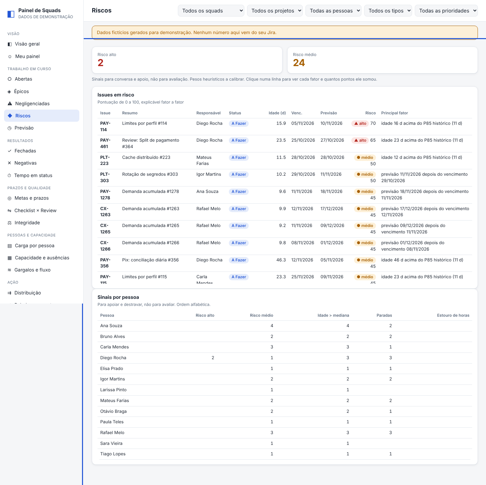

**Fatores e pontos** (somados, máximo 100):

| Fator | Pontos | Quando entra |
|---|---|---|
| Idade acima do P85 histórico | +30 | idade > P85 do ciclo histórico |
| Idade acima da mediana | +10 | só se não passou do P85, mas passou do P50 |
| Parada no status | +15 | tempo no status > max(2 d, 2 × mediana do status) |
| Vencida | +25 | vencimento já passou |
| Previsão após o vencimento | +20 | (se não vencida) previsão pela capacidade > vencimento |
| Vence em até 3 dias | +8 | (se nenhum dos dois acima) |
| Bloqueada / impedimento | +15 | categoria bloqueada ou flag |
| Reaberta | +10 | houve reabertura |
| Trocas de responsável | +10 | 3 ou mais trocas |
| Estouro de horas | +15 | horas registradas > 125% do estimado |
| Sem atualização | +10 | sem atualização há mais de 7 dias |
| Sem estimativa | +5 | sem estimativa em horas nem pontos |

**Níveis:** ▲ alto ≥ 60; ● médio de 30 a 59; ✓ baixo < 30. A tela só lista issues com score **≥ 30** (por isso "baixo" não aparece aqui).

| Card | O que mostra | Como é calculado | Interpretação / ação |
|---|---|---|---|
| **Risco alto / Risco médio** | Contagens | Issues abertas com score ≥ 60 / de 30 a 59 | Vermelho / laranja |
| **Issues em risco** | Tabela com idade, vencimento, previsão, risco e "principal fator" | Até 200 issues, maior score primeiro; clique abre a gaveta com todos os fatores | Trate as de maior score; a gaveta diz o que mudaria o número |
| **Sinais por pessoa** | Por pessoa: risco alto, médio, idade > mediana, paradas, estouro de horas | Contagem dos fatores nas issues em risco | **Para apoiar e destravar, não para avaliar.** Ordem alfabética |

### 3.7 Previsão

Quando as coisas terminam, por três métodos.

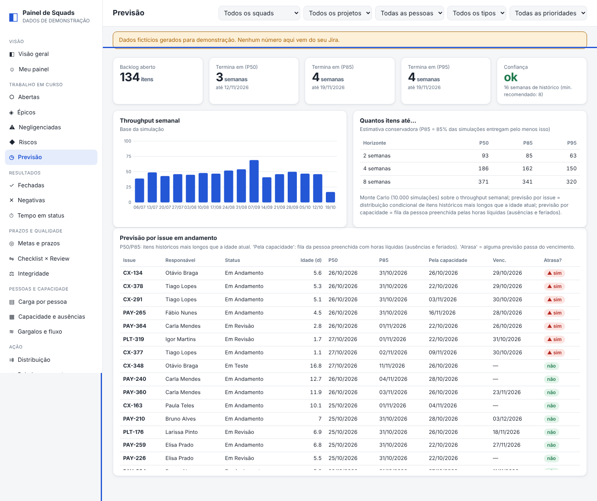

| Card | O que mostra | Como é calculado | Interpretação | Quando agir |
|---|---|---|---|---|
| **Backlog aberto** | Nº de itens abertos | Contagem | Base da simulação | — |
| **Termina em (P50 / P85 / P95)** | Semanas e data para zerar o backlog | Monte Carlo sobre o throughput das últimas 16 semanas (10.000 simulações, semente fixa) | P50 é otimista; P85 comprometimento; P95 conservador | Compare com compromissos externos |
| **Confiança** | "ok" ou "baixa" (laranja) | Baixa se < 8 semanas de histórico | Baixa = ordem de grandeza | Reduza promessas de data |
| **Throughput semanal** | Colunas de entregas por semana | Como na Visão geral, 16 semanas | Base da simulação | — |
| **Quantos itens até…** | Itens que se espera concluir em 2, 4 e 8 semanas | Simulação soma o throughput sorteado. **Percentis conservadores**: o P85 é o 15º percentil dos totais e o P95 o 5º ("85% das simulações entregam pelo menos isso") | Use P85 para planejar | — |
| **Previsão por issue em andamento** | Por issue: P50, P85 (datas), "pela capacidade", vencimento e **Atrasa?** | P50/P85: dos itens históricos com ciclo maior que a idade atual (mín. 5), quanto faltou. "Pela capacidade": fila da pessoa preenchida com horas líquidas semanais (descontando ausências e feriados), ordenada por: já iniciadas primeiro, prioridade, vencimento, criação. Atrasa = alguma previsão passa do vencimento | ▲ sim em vermelho | Verifique issues que atrasam e avalie replanejar |

Horas por issue (usadas na capacidade): horas restantes do Jira; senão estimativa − registrado (mín. 0,5 h); senão pontos × 4 h; senão 6 h (padrão configurável). Sem estimativa, a previsão perde confiança (ver Qualidade dos dados).

### 3.8 Fechadas

Entregas no período (padrão: últimos 30 dias).

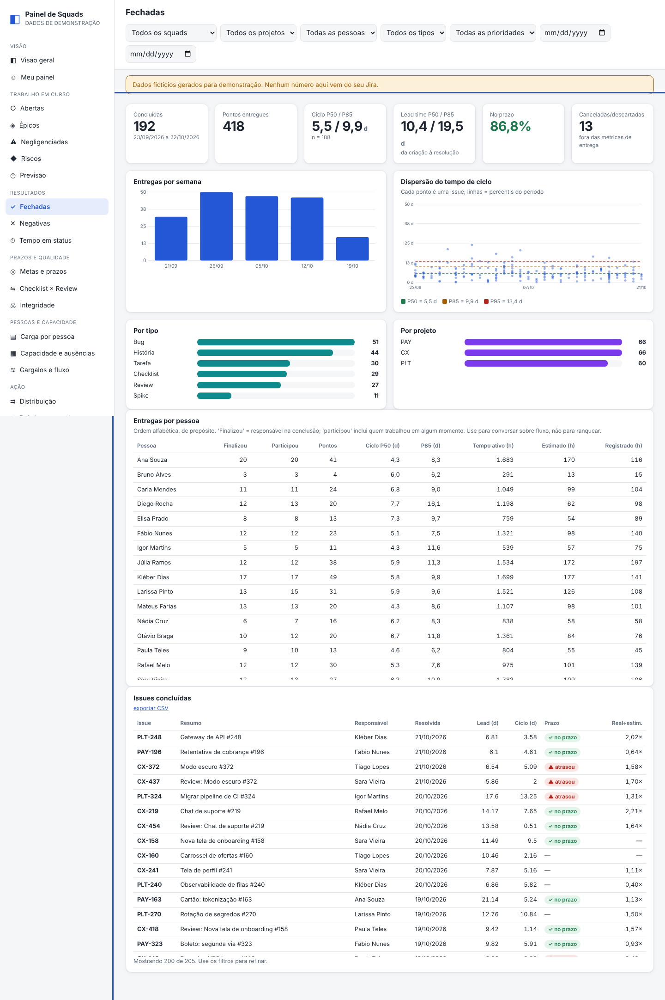

| Card | O que mostra | Como é calculado | Interpretação | Quando agir |
|---|---|---|---|---|
| **Concluídas** | Entregas no período | Resolvidas com resolução positiva | Volume | — |
| **Pontos entregues** | Soma dos story points | Soma dos pontos das concluídas | Só faz sentido se o time estima em pontos | — |
| **Ciclo P50 / P85** | Mediana e P85 do tempo de ciclo; `n` = amostra | Início em status ativo até resolução (dias corridos) | P85 diz o "pior caso normal" | P85 muito maior que P50 = cauda longa |
| **Lead time P50 / P85** | Da criação à resolução | Resolução − criação | Inclui a espera na fila | — |
| **No prazo** | % entregue até o vencimento | Entre concluídas com vencimento; laranja se < 80% | — | Ver Metas e prazos |
| **Canceladas/descartadas** | Resolvidas no período com resolução negativa | Resolução em "Cancelado", "Duplicado", "Não será feito" | Fora das métricas de entrega | Muitas = problemas de refinamento |
| **Entregas por semana** | Colunas semanais | — | — | — |
| **Dispersão do tempo de ciclo** | Um ponto por issue (dia × ciclo); linhas tracejadas P50 (verde), P85 (laranja), P95 (vermelha) | Percentis do período | Pontos acima do P95 são exceções a investigar | Investigar outliers |
| **Por tipo / Por projeto** | Entregas por tipo e por projeto | Contagem | Mix de trabalho | — |
| **Entregas por pessoa** | Finalizou, participou, pontos, ciclo P50/P85, tempo ativo, estimado, registrado | *Finalizou* = responsável na conclusão; *Participou* inclui quem trabalhou em algum momento (tempo em status ativo atribuído a quem era o responsável naquele intervalo). **Ordem alfabética de propósito** | Para conversar sobre fluxo, nunca para ranquear | — |
| **Issues concluídas** | Tabela (até 300) com lead, ciclo, **Prazo** (✓ no prazo / ▲ atrasou) e **Real÷estim.** | Real÷estim. = horas registradas ÷ estimativa original | > 1,25× é estouro | **exportar CSV** disponível |

A tabela inclui as canceladas; os totais e gráficos não.

### 3.9 Negativas

Indicadores de "o que deu errado" (padrão: últimos 90 dias).

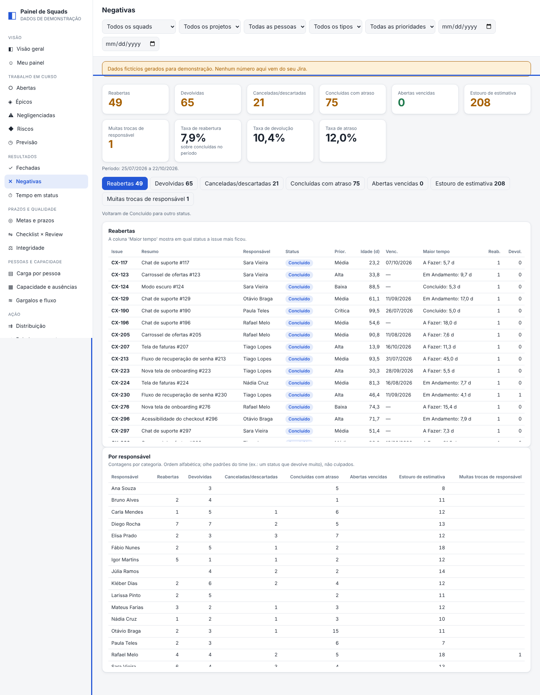

| Card | O que mostra | Como é calculado (heurístico quando indicado) | Quando agir |
|---|---|---|---|
| **Reabertas** | Voltaram de "concluído" para outro status | Transição de categoria concluída para não concluída; entra se a issue foi atualizada no período | Muitas = definição de pronto frágil |
| **Devolvidas** | Voltaram a etapa anterior do fluxo (ex.: revisão → desenvolvimento) | Transição para status anterior na ordem do fluxo (não conta reabertura) | Ver qual etapa devolve mais |
| **Canceladas/descartadas** | Resolução negativa no período | Resolução na lista de negativas | Revisar refinamento |
| **Concluídas com atraso** | Resolvidas após o vencimento | Resolução > vencimento (exclui negativas) | Ver Metas e prazos |
| **Abertas vencidas** | Abertas e já vencidas | `due < hoje` | Renegociar |
| **Estouro de estimativa** | Horas registradas > 125% do estimado | Registrado ÷ estimado > 1,25 | Revisar estimativas |
| **Muitas trocas de responsável** | 3 ou mais trocas | Contagem de mudanças de responsável | Sinal de falta de dono |
| **Taxa de reabertura / devolução / atraso** | % sobre as concluídas do período | Contagem ÷ concluídas (resolução positiva) no período; atraso vermelho se > 20% | Tendência importa mais que o valor |
| **Lista por categoria** | Abas com a lista; coluna "Maior tempo" mostra o status onde a issue mais ficou | Até 150 por categoria | Clique para a gaveta |
| **Por responsável** | Contagem por categoria e pessoa | Ordem alfabética | Procure padrões do time, não culpados |

Aviso: "reabertas", "devolvidas" e "trocas" usam a data da última atualização da issue como filtro de período, o que é uma aproximação.

### 3.10 Tempo em status

Onde as issues concluídas passam o tempo (padrão: 90 dias).

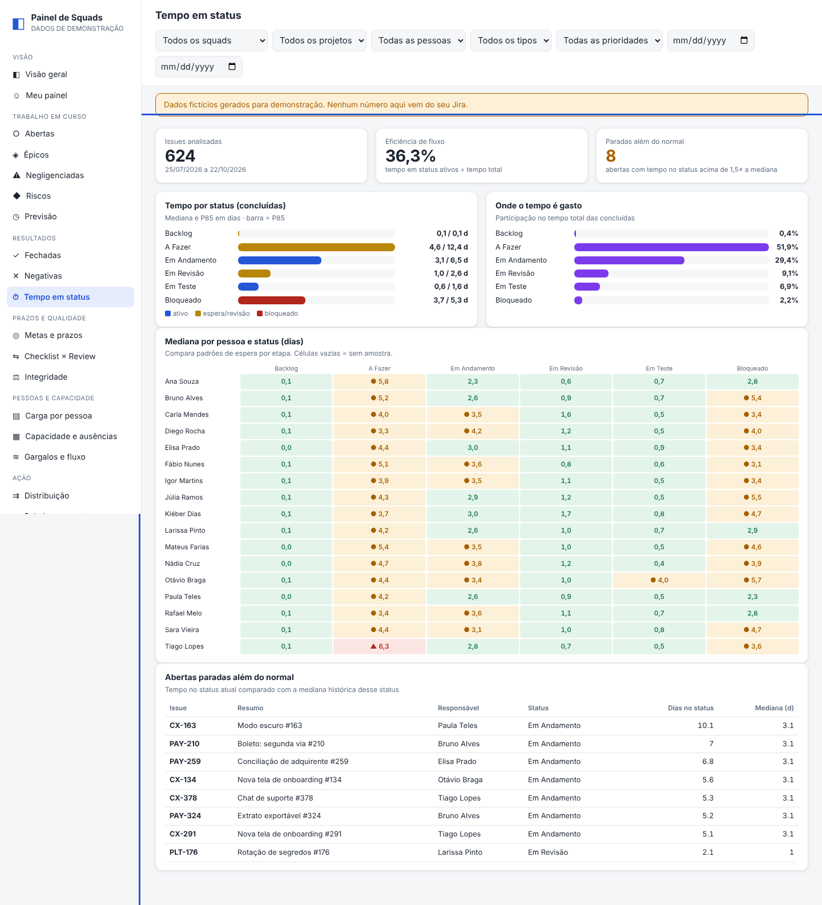

| Card | O que mostra | Como é calculado | Interpretação | Quando agir |
|---|---|---|---|---|
| **Issues analisadas** | Nº de concluídas no período | Concluídas com resolução positiva | Amostra | — |
| **Eficiência de fluxo** | % do tempo total em status ativos | Tempo em status de categoria "ativo" ÷ tempo total em todos os status não concluídos | Quanto menor, mais espera | Valores baixos mostram filas entre etapas |
| **Paradas além do normal** | Abertas com tempo no status > 1,5× a mediana (mín. 2 d) | Compara com a mediana histórica do status | Laranja se > 0 | Ver a tabela abaixo |
| **Tempo por status (concluídas)** | Mediana / P85 em dias por status; barra = P85 | Soma o tempo em cada status, incluindo reentradas | Azul ativo, roxo espera/revisão, vermelho bloqueado | Etapas de espera com P85 alto são candidatas a melhoria |
| **Onde o tempo é gasto** | Participação de cada status no tempo total | Soma do status ÷ soma de todos | — | — |
| **Mediana por pessoa e status (dias)** | Mapa de calor | Mediana por pessoa e status. Cores: ≤ 3 d verde, 3–6 d laranja ●, > 6 d vermelho ▲; vazio = sem amostra | Compara padrões de espera por etapa | Para entender processo, não pessoas |
| **Abertas paradas além do normal** | Lista com dias no status e mediana | Até 50 | — | Destravar |

### 3.11 Carga por pessoa

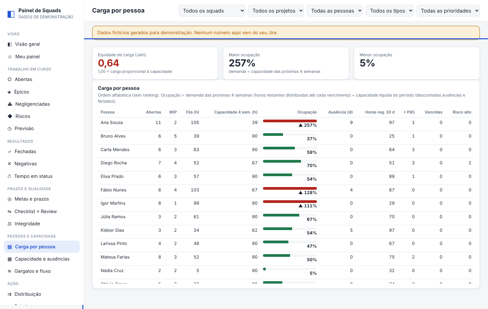

| Card | O que mostra | Como é calculado | Interpretação | Quando agir |
|---|---|---|---|---|
| **Equidade de carga (Jain)** | Índice de Jain das ocupações | (Σx)² ÷ (n · Σx²), com x = ocupação de cada pessoa (limitada a 3,0). 1,00 = carga proporcional à capacidade | ✓ ≥ 0,85; ● 0,70–0,85; ▲ < 0,70 | Abaixo de 0,85: redistribuir |
| **Maior / Menor ocupação** | Extremos da ocupação | — | Amplitude | — |
| **Carga por pessoa** (tabela, alfabética) | **Abertas**, **WIP** (em andamento), **Fila (h)** (horas restantes), **Capacidade 4 sem. (h)**, **Ocupação** (barra e %), **Ausência (d)**, **Horas reg. 30 d**, **> P85**, **Vencidas**, **Risco alto** | Ver abaixo | Ocupação: verde ≤ 85%, laranja 85–110%, vermelho ▲ > 110% | > 110%: Rebalanceamento |

**Capacidade líquida** de uma pessoa por dia útil = horas semanais ÷ 5 × fator de foco (padrão 0,7, a fração do tempo em tarefas) × alocação no squad × (1 − fração de ausência). Feriados e fins de semana contam zero. A semana corrente só conta de hoje em diante.

**Demanda semanal:** cada issue aberta espalha suas horas da semana corrente até a semana do vencimento (janela mínima de 2 semanas); sem vencimento: 2 semanas se já iniciada, 4 se não iniciada.

**Ocupação (4 semanas)** = demanda das 4 próximas semanas ÷ capacidade líquida das 4 próximas semanas. Se a capacidade é zero e há demanda, aparece 990% (valor sentinela).

### 3.12 Capacidade e ausências

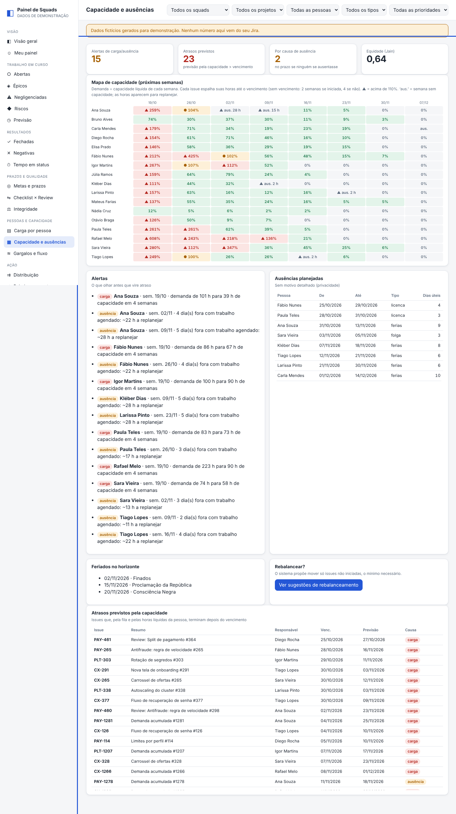

| Card | O que mostra | Como é calculado | Interpretação | Quando agir |
|---|---|---|---|---|
| **Alertas de carga/ausência** | Nº de alertas | Veja card "Alertas" | Laranja se > 0 | — |
| **Atrasos previstos** | Issues cuja previsão pela capacidade passa do vencimento | Fila da pessoa preenchida com horas líquidas | Vermelho se > 0 | Replanejar |
| **Por causa de ausência** | Dos atrasos, quantos não existiriam sem as ausências | Compara a previsão com e sem ausências | "No prazo se ninguém se ausentasse" | Redistribuir antes da ausência |
| **Equidade (Jain)** | Igual à tela anterior | — | — | — |
| **Mapa de capacidade (próximas semanas)** | Demanda ÷ capacidade de cada pessoa em cada semana (8 semanas) | Células: % com ▲ (> 110%), ● (85–110%) ou verde; **"aus."** = semana sem capacidade (as horas aparecem, ex.: "▲ aus. 28 h", para replanejar); "—" = nada | Mostra picos e efeito de férias | Semanas em ▲ pedem ação |
| **Alertas** | Lista | **Carga**: ocupação de 4 semanas > 110%. **Ausência**: semana com 2 ou mais dias de ausência e trabalho agendado (mostra ~h a replanejar) | Etiqueta vermelha (carga) ou laranja (ausência) | Antecipar |
| **Ausências planejadas** | Pessoa, período, tipo, dias úteis | Ausências com fim ≥ hoje, só membros do filtro. **Sem motivo detalhado (privacidade)** | — | — |
| **Feriados no horizonte** | Feriados nas próximas 8 semanas | Cadastro de feriados | — | — |
| **Rebalancear?** | Botão para a tela de Rebalanceamento | — | — | — |
| **Atrasos previstos pela capacidade** | Issue, resumo, responsável, vencimento, previsão e causa (**ausência** laranja / **carga** vermelha) | Previsão "além do horizonte" quando não cabe nas semanas planejadas | — | — |

### 3.13 Gargalos e fluxo

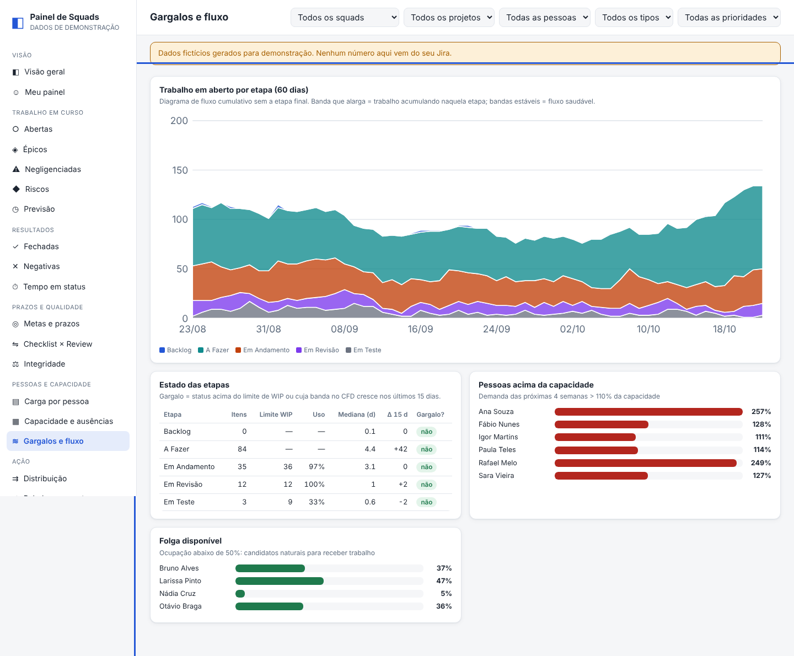

| Card | O que mostra | Como é calculado | Interpretação | Quando agir |
|---|---|---|---|---|
| **Trabalho em aberto por etapa (60 dias)** | Diagrama de fluxo cumulativo (CFD) sem a etapa final | Para cada dia dos últimos 60, conta as issues em cada status, reconstruído pelas transições | Banda que **alarga** = trabalho acumulando naquela etapa; bandas estáveis = fluxo saudável | Banda crescente: investigar |
| **Estado das etapas** | Por etapa: itens, limite WIP, uso, mediana (d), Δ 15 d, **Gargalo?** | **Gargalo = acima do limite de WIP, ou banda que cresceu nos últimos 15 dias em ≥ max(3, 30% do valor de 15 dias atrás), se a etapa é ativa ou de espera** | ▲ sim em vermelho | Limite WIP e aumento de fila |
| **Pessoas acima da capacidade** | Barras com a ocupação | Ocupação 4 semanas > 110% | Vermelho | Rebalancear |
| **Folga disponível** | Barras | Ocupação < 50%, com capacidade | Candidatos naturais a receber trabalho | Distribuir |

### 3.14 Qualidade dos dados

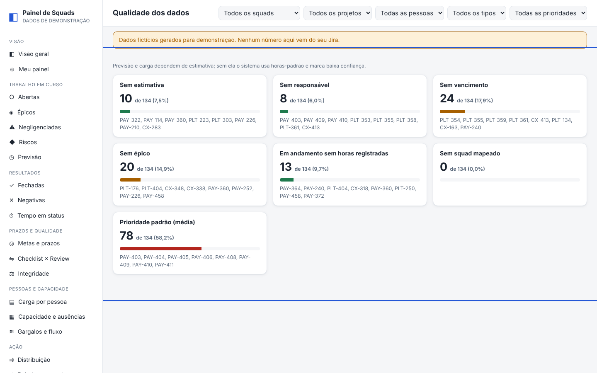

Sete verificações sobre as issues **abertas**; cada cartão mostra quantas (de quantas) e exemplos de chaves. A barra fica verde até 10%, laranja entre 10 e 30%, vermelha acima de 30%.

| Card | O que mede | Por que importa |
|---|---|---|
| **Sem estimativa** | Sem estimativa em horas **e** sem pontos | Sem isso o sistema usa 6 h por issue e a previsão perde confiança |
| **Sem responsável** | Sem pessoa atribuída | Não entra na carga de ninguém |
| **Sem vencimento** | Sem data de vencimento | Fora das metas de prazo e do cálculo de demanda por semana |
| **Sem épico** | Sem épico associado | Não aparece na tela Épicos |
| **Em andamento sem horas registradas** | Em andamento, criada há mais de 3 dias, 0 h registradas | Enfraquece "real ÷ estimado" |
| **Sem squad mapeado** | Projeto não mapeado a um squad | Fora das telas por squad |
| **Prioridade padrão (média)** | Prioridade "Média"/"Medium" | Pode indicar que ninguém priorizou |

### 3.15 Auditoria

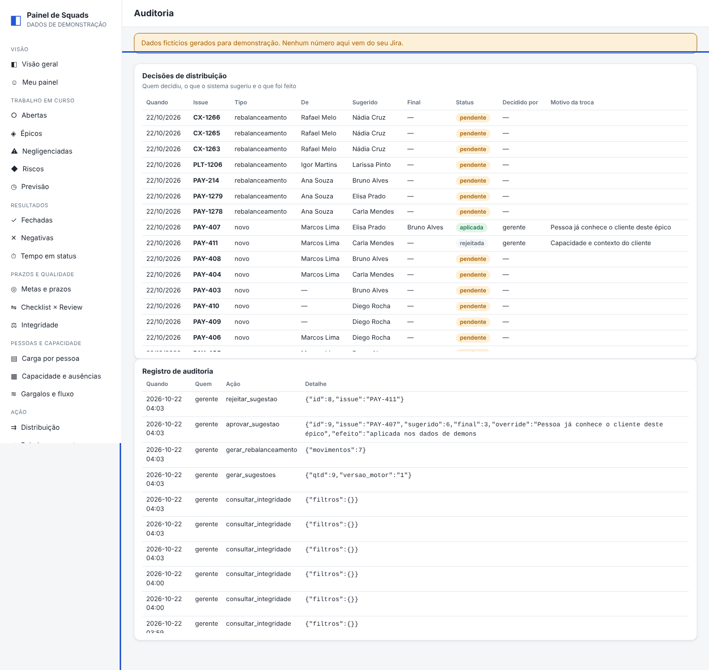

| Card | O que mostra |
|---|---|
| **Decisões de distribuição** | Cada sugestão: quando, issue, tipo (novo/rebalanceamento), de, sugerido, final, status (pendente, aprovada, aplicada, rejeitada), quem decidiu, motivo da troca |
| **Registro de auditoria** | Trilha de ações: gerar sugestões, aprovar, rejeitar, gerar rebalanceamento, sincronizar e **consultar_integridade** (a consulta à tela Integridade também é registrada, com os filtros usados). Mostra quem, quando, ação e detalhe |

Sem filtros. O "quem" vem do cabeçalho `X-User` (padrão "gerente"); em produção, propague o usuário pelo proxy/SSO.

### 3.16 Sincronização

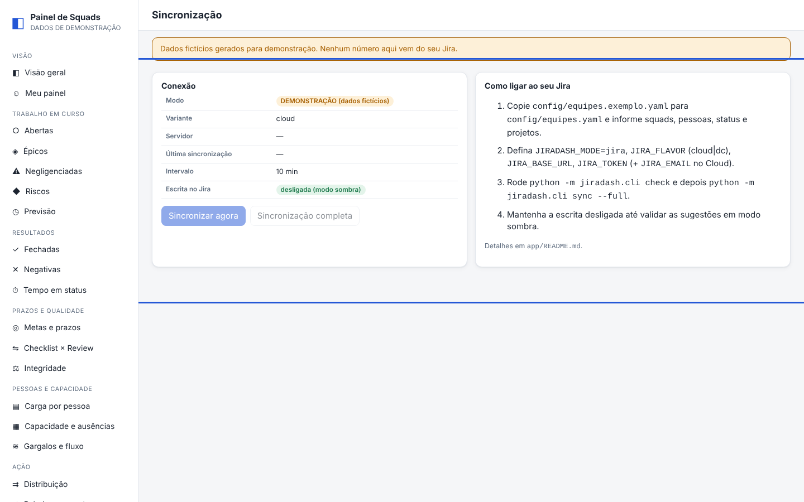

Mostra modo (DEMONSTRAÇÃO ou Jira), variante (cloud/dc), servidor, última sincronização, intervalo e se a **escrita no Jira** está ligada (padrão: desligada, modo sombra). Os botões *Sincronizar agora* e *Sincronização completa* ficam desativados no demo. O segundo cartão resume como ligar ao seu Jira (detalhes no `app/README.md`).

---

## 4. Metas e prazos

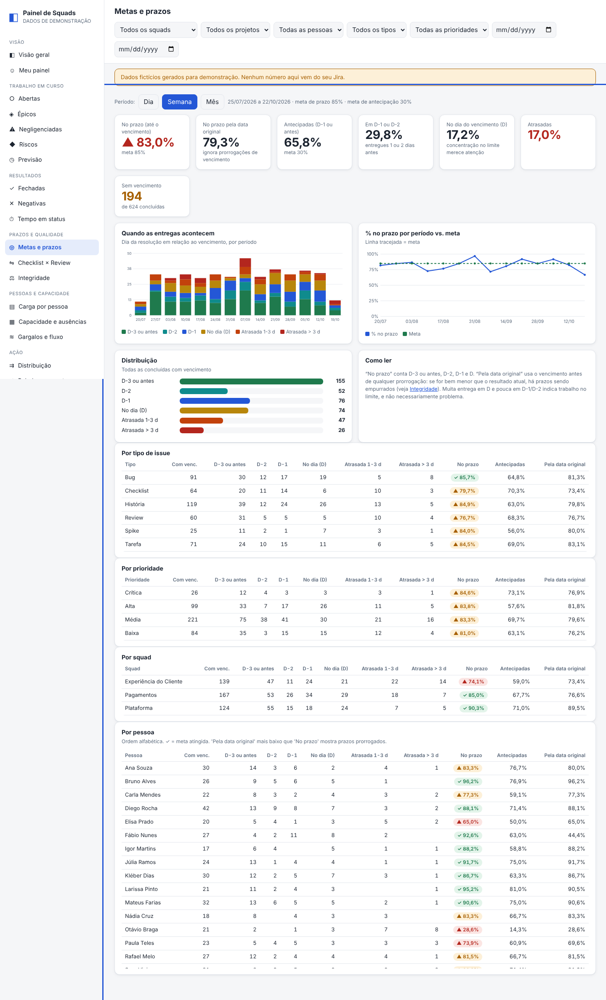

Mede **quando** as entregas acontecem em relação ao vencimento. Considera issues **concluídas com resolução positiva, com vencimento, no período** (padrão 90 dias), e **exclui o tipo "Epic"**. Issues sem vencimento são contadas à parte.

### 4.1 Buckets (faixas de dia relativo ao vencimento)

O cálculo usa o **dia da resolução no fuso local** (padrão America/Sao_Paulo) menos o dia do vencimento, em dias de calendário.

| Bucket | Regra (Δ = dia da resolução − vencimento) | Conta como "no prazo"? |
|---|---|---|
| **D-3 ou antes** | Δ ≤ −3 | Sim |
| **D-2** | Δ = −2 | Sim |
| **D-1** | Δ = −1 | Sim |
| **No dia (D)** | Δ = 0 | Sim |
| **Atrasada 1-3 d** | Δ de 1 a 3 | Não |
| **Atrasada > 3 d** | Δ > 3 | Não |

### 4.2 Cartões

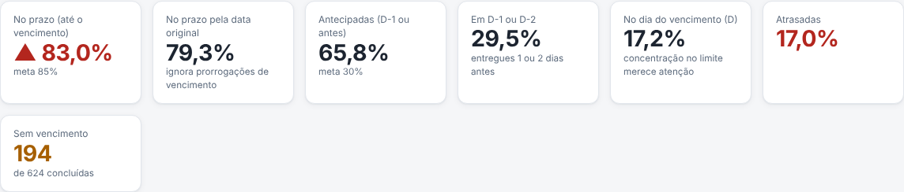

| Card | Como é calculado | Interpretação | Quando agir |
|---|---|---|---|
| **No prazo (até o vencimento)** | (D-3+, D-2, D-1 e D) ÷ total com vencimento. Mostra ✓ ou ▲ conforme a meta (config. `goals.on_time_pct`; padrão 90%, no demo 85%) | Verde se ≥ meta, vermelho abaixo | Abaixo da meta por 2 períodos seguidos |
| **No prazo pela data original** | O mesmo cálculo, mas usando o **primeiro vencimento conhecido** (antes de qualquer prorrogação): o "de" da primeira mudança de vencimento, ou o valor atual se nunca mudou | Fica laranja se for ≥ 5 pontos percentuais menor que o "No prazo". **Diferença grande = prazos sendo empurrados** | Veja a tela Integridade |
| **Antecipadas (D-1 ou antes)** | Entregas com Δ ≤ −1 ÷ total com vencimento. Meta `goals.early_pct` (padrão 35%, demo 30%) | Mostra o hábito de entregar com folga | — |
| **Em D-1 ou D-2** | Soma dos buckets D-1 e D-2 | Entregas "quase no limite" | — |
| **No dia do vencimento (D)** | Bucket D ÷ total | **Concentração no limite merece atenção** — não necessariamente problema | Olhe junto com D-1/D-2 |
| **Atrasadas** | (Atrasada 1-3 d + > 3 d) ÷ total. Vermelho se > 100 − meta | — | — |
| **Sem vencimento** | Concluídas no período sem data | Laranja se > 0 | Preencher vencimento (Qualidade) |

### 4.3 Gráficos e tabelas

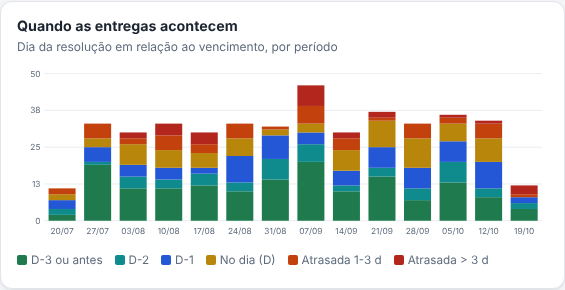

| Card | O que mostra | Como interpretar |
|---|---|---|
| **Quando as entregas acontecem** | Colunas empilhadas por período (dia/semana/mês) com os seis buckets (verde escuro D-3+, verde-água D-2, azul D-1, amarelo D, laranja atrasada 1-3 d, vermelho > 3 d) | Muito amarelo/laranja/vermelho = trabalho no limite ou atrasado |
| **% no prazo por período vs. meta** | Linha azul = % no prazo (D-3+ até D) por período; tracejada verde = meta | Linha abaixo da tracejada = período abaixo da meta |
| **Distribuição** | Total do período por bucket | Visão geral |
| **Como ler** | Texto de apoio na tela | — |
| **Por tipo de issue / Por prioridade / Por squad / Por pessoa** | Tabelas com total com vencimento, contagem por bucket, **No prazo** (pílula ✓ verde se ≥ meta, ● laranja se até 10 pontos abaixo, ▲ vermelha abaixo disso), **Antecipadas** e **Pela data original** | Em "Por pessoa" (alfabético), uma "Pela data original" bem menor que "No prazo" mostra prazos prorrogados |

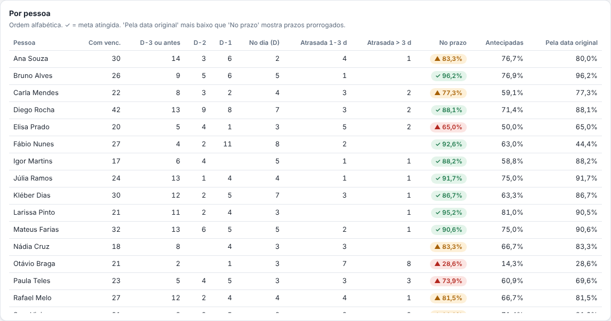

**Como usar:** compare "No prazo" com "Pela data original". Se a primeira é alta e a segunda baixa (no demo, **Fábio Nunes: 92,6% × 44,4%**), há prorrogações que "salvam" a meta. Isso é um indício, não uma conclusão: prorrogações legítimas (pedido do cliente) existem. Confirme em **Integridade**.

Observação: a tabela "Por tipo" inclui os tipos Checklist e Review (só "Epic" é excluído).

---

## 5. Checklist × Review

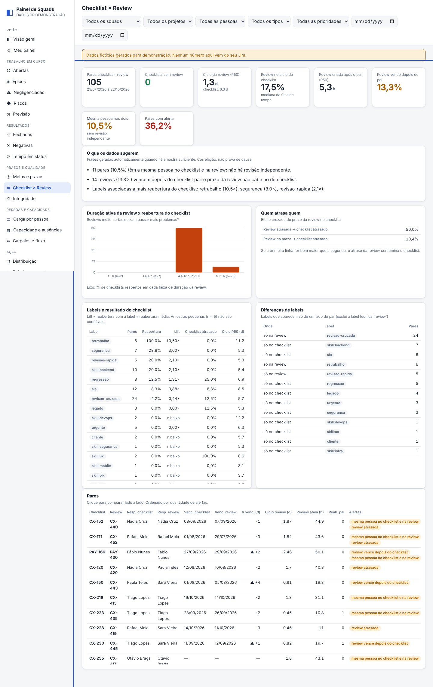

Esta tela pressupõe um processo em que cada trabalho tem uma issue **Checklist** (pai) e uma issue **Review** (filha, ligada pelo campo "pai"). Os tipos são configuráveis (`checklist_types`, `review_types`; padrão "Checklist" e "Review"). A tela analisa **pares pai/filha**: se um checklist tem várias reviews, cada combinação é um par.

**Escopo:** checklists resolvidos no período (padrão 90 dias) ou ainda abertos; os filtros de squad/projeto/pessoa/tipo/prioridade aplicam-se **ao checklist**. Checklists sem review filha são listados à parte.

### 5.1 Cartões

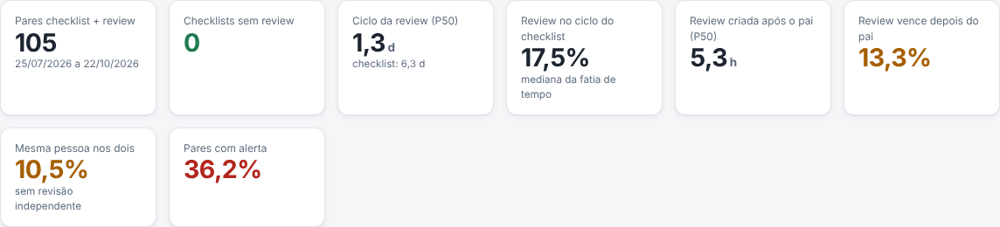

| Card | Como é calculado | Interpretação / ação |
|---|---|---|
| **Pares checklist + review** | Nº de pares no período | Amostra |
| **Checklists sem review** | Checklists do período sem filha do tipo review | Laranja se > 0. Criar a review ou justificar |
| **Ciclo da review (P50)** | Mediana do ciclo da review (1ª entrada ativa → resolução); rodapé: ciclo do checklist | Compare os dois |
| **Review no ciclo do checklist** | Mediana de (ciclo da review ÷ ciclo do checklist) | Que fatia do tempo do pai a review ocupa |
| **Review criada após o pai (P50)** | Mediana de horas entre a criação do checklist e a da review | Review criada tarde = revisão deixada para o fim |
| **Review vence depois do pai** | % de pares em que o vencimento da review é posterior ao do checklist | Laranja se > 10%. O prazo da review não cabe no do pai |
| **Mesma pessoa nos dois** | % de pares com o mesmo responsável nos dois | Laranja se > 10%. Sem revisão independente |
| **Pares com alerta** | % de pares com pelo menos um alerta | Vermelho se > 30% |

### 5.2 Alertas por par

| Alerta | Regra |
|---|---|
| review vence depois do checklist | vencimento da review > vencimento do pai |
| checklist fechado antes da review | pai resolvido e review não resolvida, ou resolvida depois do pai |
| mesma pessoa no checklist e na review | mesmo responsável |
| review muito curta e checklist reaberto | review resolvida com menos de 0,5 h em status ativo **e** pai reaberto |
| review vencida | review aberta com vencimento passado |
| review atrasada | review resolvida depois do vencimento (data local) |

### 5.3 Diferenças de datas e labels

Na tabela **Pares** (clique para comparar) aparecem: responsáveis, vencimentos, **Δ venc. (d)** (vencimento da review menos o do checklist; **▲ +n** quando a review vence depois), ciclo da review, **review ativa (h)** (tempo em status ativo), reaberturas do pai e alertas. Ordenação padrão: mais alertas primeiro.

**Diferenças de labels** lista as labels que aparecem só de um lado do par (exclui a label técnica "review"). Serve para ver se a review herda o contexto do pai (ex.: "urgente" no checklist e não na review).

### 5.4 Comparação lado a lado

Clique numa linha da tabela **Pares** para abrir a comparação:

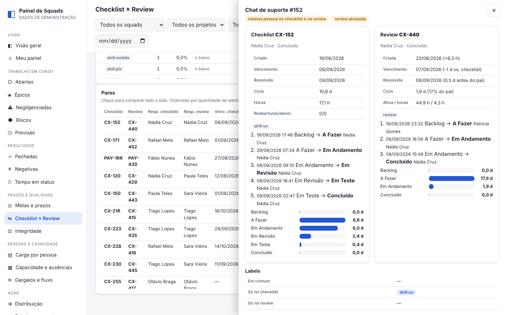

À esquerda o checklist, à direita a review: criação, vencimento (com "−1 d vs. checklist"), resolução (e "0,5 d antes do pai"), ciclo (e % do ciclo do pai), horas, reaberturas/devoluções, **linha do tempo** das transições com autor e o gráfico de dias por status. Embaixo, as labels **em comum**, **só no checklist** e **só na review**. No alto, os alertas do par.

### 5.5 "O que os dados sugerem" (aprendizados)

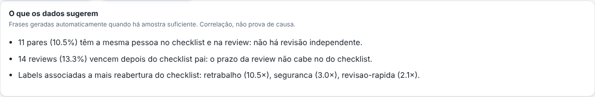

Frases geradas automaticamente **somente quando há amostra suficiente**: (1) reabertura em reviews < 1 h ativas contra ≥ 12 h (precisa ≥ 5 pares em cada faixa); (2) quantos pares têm a mesma pessoa; (3) quantas reviews vencem depois do pai; (4) quantos checklists fecharam antes da review; (5) labels com lift ≥ 1,5 (n ≥ 5); (6) checklists sem review. **É correlação, não prova de causa.**

### 5.6 Duração da review × reabertura, "Quem atrasa quem" e labels

| Card | O que mostra | Como ler |
|---|---|---|
| **Duração ativa da review x reabertura do checklist** | Faixas < 1 h, 1 a 4 h, 4 a 12 h, ≥ 12 h; coluna = % de checklists reabertos em cada faixa (n entre parênteses) | Reviews muito curtas deixam passar mais problemas? |
| **Quem atrasa quem** | "Review atrasada → checklist atrasado" = % dos pares com review atrasada em que o pai também atrasou; "Review no prazo → checklist atrasado" = idem com review no prazo | Se a 1ª linha for bem maior que a 2ª, o atraso da review contamina o checklist |
| **Labels e resultado do checklist** | Por label: pares, reabertura %, **Lift**, % de checklist atrasado, ciclo P50 | Ver abaixo |
| **Diferenças de labels** | Labels em um lado só, com contagem de pares | Ver 5.3 |
| **Checklists sem review** | Lista (só aparece se houver) | Tratar |

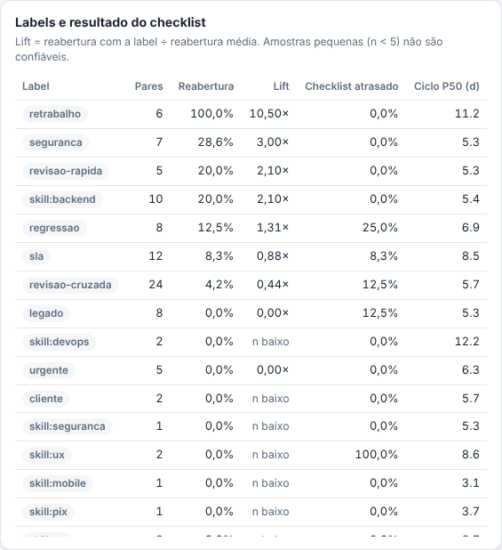

### 5.7 Como ler o lift

**Lift = reabertura com a label ÷ reabertura média de todos os pares.** Lift 1,00× = igual à média; 1,50× = a label vem com 50% mais reaberturas que a média; 0,50× = metade. Com **n < 5** a tela mostra "n baixo": não confie. A tabela vem ordenada por lift decrescente. Uma label com lift alto não "causa" retrabalho; pode apenas marcar trabalho mais complexo (ex.: "seguranca"). Use para escolher onde olhar.

---

## 6. Integridade

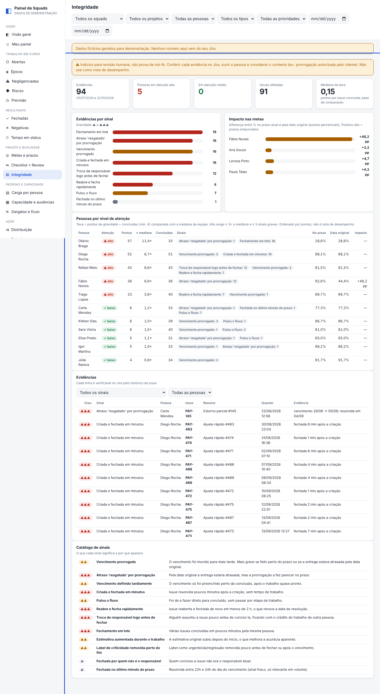

### 6.1 Para que serve — e o que ela NÃO é

A tela procura **padrões nos históricos do Jira** que melhoram os números sem melhorar o trabalho (prazos empurrados, issues criadas e fechadas em minutos etc.). Ela mostra **indícios para revisão humana**, **não prova de má-fé** e **não é nota de desempenho** (aviso fixo no topo da tela). Cada linha é verificável no Jira pelo histórico da issue.

### 6.2 Os sinais

Gravidade: ▲ = 1 ponto, ▲▲ = 2, ▲▲▲ = 3. O período considera issues resolvidas no intervalo (padrão 90 dias) e eventos de vencimento dentro dele.

| Sinal | Grav. | Regra de detecção |
|---|---|---|
| **Atraso "resgatado" por prorrogação** | 3 | Vencimento movido para mais tarde, e a issue foi resolvida depois do vencimento antigo mas até o novo: pela data original estaria atrasada |
| **Troca de responsável logo antes de fechar** | 3 | Alguém assumiu a issue ≤ 2 h antes da conclusão e foi quem a concluiu (apropriação do trabalho de outro) |
| **Criada e fechada em minutos** | 3 | Resolvida menos de 15 min após a criação |
| **Reabre e fecha rapidamente** | 3 | Reaberta e refechada em menos de 2 h (com fechamento anterior também a menos de 2 h), renovando a data de resolução |
| **Fechamento em lote** | 3 | 6 ou mais issues concluídas pela mesma pessoa em janela de 10 min |
| **Vencimento prorrogado** | 2 | Vencimento movido para mais tarde, a ≤ 2 dias do prazo antigo ou depois dele, sem ser "resgate" |
| **Vencimento definido tardiamente** | 2 | Vencimento preenchido quando já se passou mais de 70% do tempo de vida da issue |
| **Pulou o fluxo** | 2 | Nunca passou por status de trabalho e tem 0 h registradas |
| **Estimativa aumentada durante o trabalho** | 2 | Estimativa subiu ≥ 30% depois do início |
| **Label de criticidade removida perto do fim** | 2 | Label urgente/sla/regressao removida após o vencimento ou a menos de 3 dias da conclusão |
| **Fechada por quem não é o responsável** | 1 | Quem concluiu não era o responsável atual e não é gerente de squad |
| **Fechada no último minuto do prazo** | 1 | Resolvida entre 22h e 24h do dia do vencimento (sinal fraco, só relevante em volume) |

Alguns sinais ocorrem normalmente em equipes saudáveis (por isso há "baixo": no demo, todos têm um ou outro).

### 6.3 Nível de atenção por pessoa

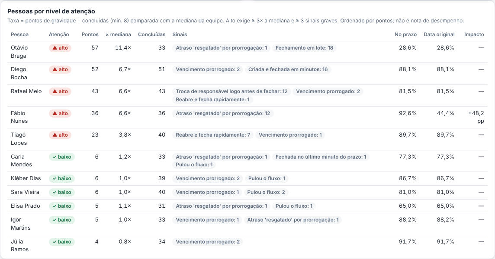

1. **Pontos** = soma das gravidades das evidências atribuídas à pessoa.
2. **Taxa** = pontos ÷ max(concluídas da pessoa, 8). O mínimo de 8 evita taxas infladas por amostra pequena.
3. **× mediana** = taxa da pessoa ÷ mediana das taxas da equipe (piso de 0,05 na mediana).
4. **Nível:**
   - **▲ alto**: pontos ≥ 12 **e** × mediana ≥ 3 **e** pelo menos 3 sinais de gravidade 3;
   - **● médio**: pontos ≥ 6 **e** × mediana ≥ 2;
   - **✓ baixo**: o resto.

(O texto de ajuda na tela cita apenas "≥ 3× a mediana e ≥ 3 sinais graves" para o alto; o código exige também 12 pontos.) Os limites são **heurísticos**. Ao lado aparecem as colunas **No prazo**, **Data original** e **Impacto** (diferença em pontos percentuais): é o efeito do sinal de prazo nas metas.

### 6.4 Demais cartões

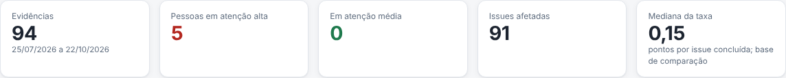

| Card | O que mostra |
|---|---|
| **Evidências** | Total de ocorrências de sinais no período |
| **Pessoas em atenção alta / média** | Nº de pessoas em cada nível |
| **Issues afetadas** | Issues distintas com algum sinal |
| **Mediana da taxa** | Pontos por issue concluída; base de comparação |
| **Evidências por sinal** | Barras por sinal (vermelho gravidade 3, laranja 2, cinza 1) |
| **Impacto nas metas** | Por pessoa, "No prazo" − "Pela data original" (só valores positivos): **positivo alto = prazos empurrados** |
| **Evidências** (tabela) | Gravidade, sinal, pessoa, issue, resumo, quando e detalhe (ex.: "vencimento 29/08 → 05/09; resolvida em 04/09"). Filtros por sinal e por pessoa; clicar numa linha da tabela de pessoas filtra as evidências dela |
| **Catálogo de sinais** | O que cada sinal significa |

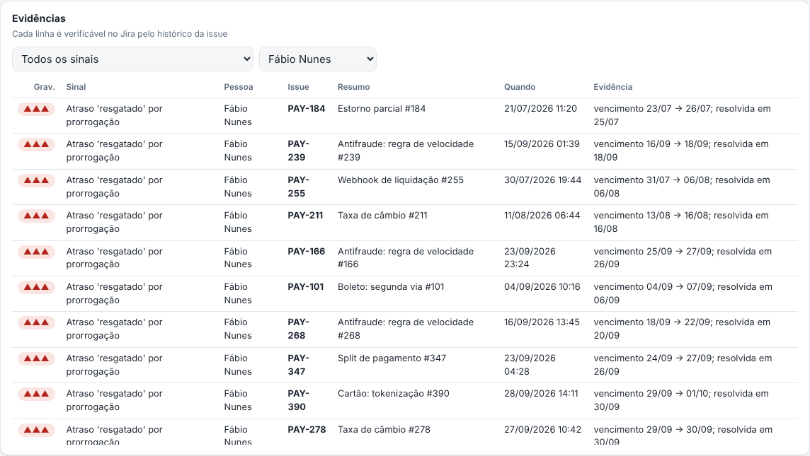

### 6.5 Cuidados éticos e LGPD

- **Não é prova.** Prorrogação pode ter sido autorizada pelo cliente; issue "criada e fechada em minutos" pode ser registro retroativo legítimo; fechamento em lote pode ser limpeza de backlog.
- **Não use como nota de desempenho** nem como ranking. O painel não gera nota composta por pessoa.
- **Base legal e comunicação:** trata-se de dados pessoais de empregados. Antes de usar com dados reais, valide a base legal, a finalidade e a transparência com a equipe e o DPO (o README informa que a análise jurídica usou só fontes secundárias).
- **Consulta é auditada:** cada abertura da tela é registrada na Auditoria (quem e com quais filtros).
- **Minimização:** ausências são guardadas sem motivo; tabelas de pessoas saem em ordem alfabética.

### 6.6 O que fazer ao ver um indício

1. Abra a issue no Jira (clique na chave) e leia o **histórico**: confira datas, autores e comentários.
2. Considere o contexto: pedido do cliente, mudança de escopo, correção de dados.
3. **Converse com a pessoa primeiro**, de forma aberta e de apoio; pergunte o que aconteceu.
4. Procure causas de processo: prazos irreais, falta de capacidade, métricas que incentivam o comportamento.
5. Só trate como questão disciplinar com evidências confirmadas e seguindo o processo da empresa.
6. Se o padrão for do time (muitos "resgates" em vários), é problema de planejamento, não de uma pessoa.

---

## 7. Distribuição e Rebalanceamento

O modo é **sugerir e aprovar**: o sistema calcula e explica; **nada é atribuído sem a decisão de um gerente**. A escrita no Jira vem **desligada**.

### 7.1 Tela Distribuição

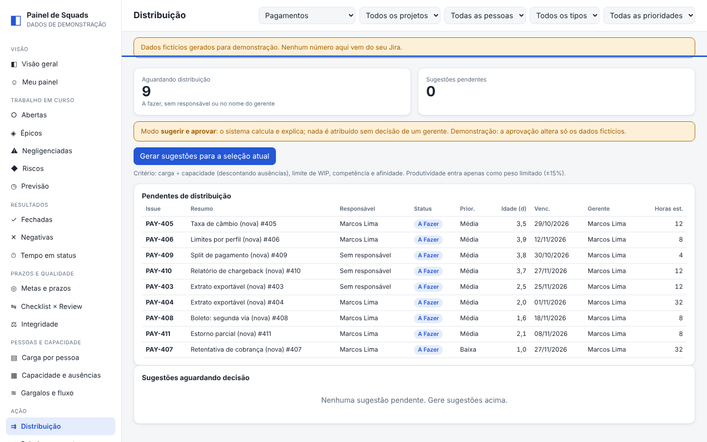

| Card | O que mostra |
|---|---|
| **Aguardando distribuição** | Issues em "a fazer" sem responsável ou no nome do gerente do squad (respeita só o filtro de squad) |
| **Sugestões pendentes** | Sugestões do tipo "novo" ainda sem decisão |
| **Faixa de modo** | Explica o modo; no demo: "a aprovação altera só os dados fictícios"; em Jira real sem escrita: "modo sombra" |
| **Gerar sugestões para a seleção atual** | Botão que calcula as sugestões para o squad do filtro (ou todos) |
| **Pendentes de distribuição** | Tabela das issues a distribuir, com horas estimadas |
| **Sugestões aguardando decisão** | Cartões com a recomendação, o motivo, o ranking e os botões de decisão |

Ao gerar, aparece um cartão por squad com a **equidade antes → depois** (Jain) e a maior e a menor ocupação projetadas:

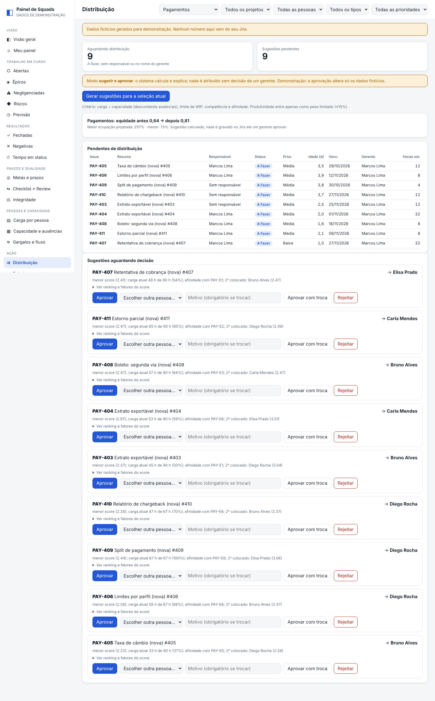

### 7.2 Como o score funciona

Para cada issue nova e cada pessoa elegível (capacidade das 4 semanas > 0,5 h):

```
score = carga projetada ÷ capacidade efetiva
        + 0,5 × (WIP ÷ limite de WIP) + 1,0 se WIP ≥ limite
        + 0,6 × competências exigidas que faltam
        − 0,15 se já trabalhou no mesmo épico/componente
```

- **Carga projetada** = (horas já comprometidas nas 4 semanas + horas da issue) ÷ capacidade líquida (já sem férias, licenças e feriados) × **peso de produtividade**.
- O **peso de produtividade** é o throughput relativo da pessoa nas últimas 12 semanas, **suavizado** (puxado para 1,0 quando há pouco histórico) e **limitado a 0,85–1,15 (±15%)**: produtividade entra só como peso de capacidade, para não punir quem entrega mais nem premiar quem entrega menos.
- **Competências** vêm das labels `skill:xxx` da issue comparadas às competências cadastradas da pessoa.
- **Menor score vence.** Empate: quem recebeu há mais tempo. Os itens são processados do maior para o menor em horas, e cada atribuição atualiza a carga antes da próxima.
- Se ninguém tem capacidade: "ninguém com capacidade disponível no horizonte".
- Os pesos (1,0; 0,5; 1,0; 0,6; 0,15) são **heurísticos**, ficam no topo de `distribution/engine.py` (versão "1") e devem ser calibrados com o histórico do time.

**Ver ranking e fatores do score:** abra o item "Ver ranking e fatores do score" em cada sugestão:

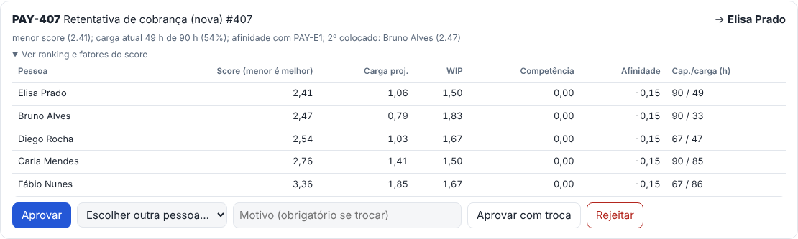

Colunas: **Score** (menor é melhor), **Carga proj.**, **WIP**, **Competência** (0 = tem tudo), **Afinidade** (negativa = bônus) e **Cap./carga (h)** (capacidade e carga atuais da pessoa). Mostra até os 5 primeiros colocados. O texto do motivo traz o menor score, a carga atual e o segundo colocado.

### 7.3 Decidir: aprovar, trocar com motivo, rejeitar

| Ação | Como | Efeito |
|---|---|---|
| **Aprovar** | Botão *Aprovar* | Aceita a pessoa sugerida |
| **Aprovar com troca** | Escolha *outra pessoa* na lista, escreva o **motivo (obrigatório ao trocar)** e clique em *Aprovar com troca* | Atribui à pessoa escolhida; o motivo vai para a auditoria. Sem motivo, a decisão é recusada (erro 422) |
| **Rejeitar** | Botão *Rejeitar* (pede motivo opcional) | A sugestão fica "rejeitada"; nada é atribuído |


**O que acontece depois da aprovação:**

- **Demonstração:** o status vira "aplicada" e a atribuição é gravada **nos dados fictícios**.
- **Jira real, escrita desligada (modo sombra — padrão):** o status vira "aprovada" e a decisão fica **só na auditoria**; **nada é gravado no Jira**.
- **Jira real, `JIRADASH_ALLOW_WRITE=1`:** verifica se a pessoa é atribuível (senão erro 409), grava no Jira e marca "aplicada".

### 7.4 Modo sombra

Recomenda-se comparar por algumas semanas as sugestões com o que o gerente faria e só então ligar a escrita. Na tela Auditoria, compare "Sugerido" com "Final" e leia os "Motivos da troca". Muitas trocas com o mesmo motivo indicam algo que o score não considera (calibre os pesos ou cadastre a competência).

### 7.5 Tela Rebalanceamento


**Gatilho:** ocupação projetada **acima de 110%** nas próximas 4 semanas (já inclui férias e licenças). O botão *Calcular rebalanceamento* propõe movimentos; cada cartão diz "mover de X" para Y e explica ("X projetado em 178% da capacidade; Y fica em 112% após o movimento"). Regras:

- Só são movidas issues **não iniciadas** ("a fazer"), para não gerar troca de contexto.
- **Mínimo necessário:** até 10 movimentos; começa por quem está mais acima do limite e pelos itens maiores.
- **Histerese:** só move se a diferença de ocupação entre origem e destino superar 20 pontos percentuais; sem ganho claro, nada é movido.
- O destino é escolhido pelo mesmo score da Distribuição, **excluindo** quem não tem a competência exigida.
- Aprovar, trocar com motivo e rejeitar funcionam como na Distribuição.

O cartão **Movimentos aguardando decisão** lista os movimentos pendentes (cada um com ranking e botões de decisão). O resultado de "Calcular" mostra por squad o número de movimentos, a equidade (Jain) antes → depois e a maior ocupação antes → depois. "Nada a mover: carga dentro do limite" aparece quando não há o que mover.


> Observação: pode ocorrer de o destino ficar acima de 110% depois do movimento (ex.: "fica em 112%"), porque a regra é "melhorar com ganho claro", não "zerar o excesso".

---

## 8. Como ler os dados do demonstração

- **São fictícios**, gerados aleatoriamente (aproximadamente 900 issues, 3 squads, 20 pessoas), em datas **relativas a hoje**: por isso as datas das imagens deste manual (outubro de 2026) mudam a cada execução. Uma faixa fixa no topo avisa: "Dados fictícios gerados para demonstração. Nenhum número aqui vem do seu Jira."
- Squads: **Pagamentos** (PAY), **Plataforma** (PLT), **Experiência do Cliente** (CX). Gerentes (Marcos Lima, Helena Costa, Patrícia Gomes) não aparecem no filtro Pessoa.
- Status do demo: Backlog e A Fazer (a fazer), Em Andamento e Em Teste (ativos), Em Revisão (espera), Bloqueado, Concluído e Cancelado (concluído).
- Metas do demo: 85% no prazo e 30% de antecipação.
- **Padrões de adulteração plantados em 5 pessoas fictícias**, **só para demonstrar a tela Integridade**:

| Pessoa (fictícia) | Padrão plantado | O que aparece em Integridade |
|---|---|---|
| Fábio Nunes | Prazos empurrados | "Atraso resgatado por prorrogação" (12); "No prazo" 92,6% × "Pela data original" 44,4% (impacto de cerca de +48 pp) |
| Diego Rocha | Fechamentos instantâneos | "Criada e fechada em minutos" (16) |
| Tiago Lopes | Reabre e fecha | "Reabre e fecha rapidamente" (7) |
| Rafael Melo | Apropriação do trabalho alheio | "Troca de responsável logo antes de fechar" (12) |
| Otávio Braga | Fechamento em lote | "Fechamento em lote" (18) |

Essas pessoas aparecem com nível **alto**; as demais, com **baixo** (ruído natural dos dados: algumas prorrogações e issues "puladas"). Os números exatos variam entre execuções.

- Capacidade: 40 h semanais por pessoa (30 h e 32 h para alguns), fator de foco 0,7; ausências e feriados gerados em torno de hoje. As ocupações muito altas na primeira semana do demo (ex.: 600%) são efeito da carga acumulada artificial das issues "Demanda acumulada", não representam um padrão real.
- Em **Sincronização**, os botões ficam desativados no demo, e a aprovação de sugestões altera só os dados fictícios.

---

## 9. Glossário

| Termo | Definição neste painel |
|---|---|
| **Lead time** | Tempo da **criação** à **resolução** da issue (inclui a espera na fila). Dias corridos. |
| **Cycle time (ciclo)** | Da **primeira entrada** em status ativo, de espera ou bloqueado até a **resolução**. Dias corridos, não úteis. |
| **Idade (work item age)** | Agora menos a 1ª entrada em status em andamento (ou a criação, se nunca iniciou). |
| **WIP** | *Work in progress*: itens em andamento (categorias ativa, espera, bloqueada). Há limite por pessoa (3, no demo) e por status. |
| **Aging** | Acompanhamento da idade dos itens abertos contra os percentis históricos. |
| **P50 / P85 / P95** | Percentis: 50% / 85% / 95% dos itens têm valor menor ou igual. P50 = mediana. Em previsões, P85 é o "compromisso seguro". Em "Quantos itens até…" o sentido se inverte: P85 = valor que 85% das simulações alcançam ou superam. |
| **Throughput** | Itens concluídos por unidade de tempo (aqui, por semana, de segunda a domingo). |
| **Monte Carlo** | Simulação que sorteia, com reposição, semanas do throughput histórico milhares de vezes para estimar distribuições de resultado. |
| **Índice de Jain** | (Σx)² ÷ (n·Σx²). Mede equidade: 1,00 = todos com a mesma carga relativa; menor = mais concentração. |
| **Ocupação** | Demanda das próximas 4 semanas ÷ capacidade líquida do mesmo período. |
| **Capacidade líquida** | Horas disponíveis após descontar fins de semana, feriados, ausências, fator de foco e alocação. |
| **Fator de foco** | Fração do tempo semanal que vai para tarefas (padrão 0,7). |
| **Lift** | Reabertura com a label ÷ reabertura média (Checklist × Review). |
| **D, D-1, D-2, D-3** | Dia do vencimento (D) e 1, 2 ou 3 dias antes. "D-3 ou antes" agrupa tudo isso e anteriores. |
| **Data original** | Primeiro vencimento conhecido da issue, antes de prorrogações. |
| **Reabertura** | Transição de "concluído" para outra categoria. |
| **Devolução** | Transição para um status anterior na ordem do fluxo. |
| **Resolução negativa** | Cancelado, Duplicado, Não será feito (configurável): fora das métricas de entrega. |
| **Eficiência de fluxo** | % do tempo total em status ativos. |
| **CFD** | Diagrama de fluxo cumulativo: quantas issues em cada etapa ao longo do tempo. |
| **Histerese** | Exigir ganho mínimo antes de mudar, para evitar movimentos de ida e volta. |
| **Modo sombra** | O sistema registra a decisão, mas não grava no Jira. |
| **Heurístico** | Regra ou peso escolhido por convenção e bom senso, sem validação estatística; ajuste ao seu time. |
| **Categoria de status** | Mapeamento dos nomes de status do Jira em: a fazer (`todo`), ativo (`active`), espera (`wait`), bloqueado (`blocked`), concluído (`done`). |

---

## 10. Perguntas frequentes e solução de problemas

**A tela abre com "Carregando…" e não sai disso.**
Algumas telas fazem cálculos pesados e levam de 1 a 3 segundos. Se passar de alguns segundos, veja se aparece o cartão "Não foi possível carregar" com a mensagem de erro, recarregue (F5) e confirme na tela **Sincronização** se o serviço está respondendo.

**"Sem acesso à API".**
Se a chave de API estiver ativa no servidor, grave-a no navegador: no console, `localStorage.setItem('apiKey','sua-chave')`, e recarregue. O nome do usuário nas decisões vem de `localStorage.setItem('usuario','Seu Nome')`.

**A tela está vazia ou diz "Nada por aqui" / "Sem dados".**
Confira os filtros: a combinação pode não ter issues (ex.: tipo "Spike" na prioridade "Crítica"). Para telas com período (Fechadas, Negativas, Tempo em status, Metas, Review, Integridade), amplie o intervalo De/Até. "Sem histórico suficiente" em previsões significa que não há entregas semanais para simular.

**"Meu painel" mostra apenas uma mensagem.**
Escolha uma pessoa no filtro *Pessoa* (ou use `#/meu?person=ID`).

**Os números diferem dos do Jira.**
Causas comuns: (1) o painel usa **dias corridos**, não úteis; (2) conta como "concluída" pela **categoria do status** mapeada em `equipes.yaml`, não pelo campo resolução; (3) **exclui canceladas/duplicadas** das métricas de entrega; (4) data de resolução e vencimento para "no prazo" usam fuso local em Metas e prazos, e a data da resolução em UTC em alguns cartões (Visão geral, Fechadas), o que pode mover issues resolvidas à noite para outro dia; (5) dados em cache por até 60 s; (6) a última sincronização pode estar atrasada (veja *Sincronização*); (7) os cartões "30 d" da Visão geral e os de 90 dias de Metas usam períodos diferentes; (8) filtros ativos. Faça uma conferência por amostra: abra uma issue na gaveta e compare datas e status com o Jira.

**Um status aparece sem cor / "status não mapeado".**
O status do Jira não está no `status_map` de `config/equipes.yaml`. Rode `python -m jiradash check`, que lista status sem mapeamento, adicione com a categoria correta (`todo|active|wait|blocked|done`) e sincronize de novo. Sem mapeamento, ciclo, idade e WIP ficam errados.

**O ciclo de várias issues aparece como "—".**
O ciclo só existe se a issue passou por um status ativo/espera/bloqueado. Issues que foram direto de "a fazer" a "concluído" ficam sem ciclo (e aparecem como "pulou o fluxo" na Integridade).

**As previsões parecem otimistas/pessimistas.**
Verifique **Confiança** (menos de 8 semanas = baixa), **Qualidade dos dados** (sem estimativa usa 6 h por issue) e se o filtro deixou o histórico curto. O Monte Carlo assume o ritmo recente e que nenhum item novo entra.

**A ocupação passa de 100% de forma exagerada.**
A demanda considera todas as issues abertas com sua data de vencimento; issues vencidas ou com vencimento próximo concentram horas na semana corrente. Também há o valor sentinela (990%) quando a capacidade da pessoa é zero com demanda. Revise estimativas, vencimentos e ausências.

**Por que o painel não tem ranking de pessoas?**
É decisão de privacidade e de método: métricas de fluxo medem o sistema de trabalho, e rankings individuais distorcem comportamento. As tabelas de pessoas são alfabéticas.

**A aprovação de uma sugestão não mudou nada no Jira.**
Esperado: a escrita vem desligada (modo sombra). A decisão fica registrada na Auditoria com status "aprovada". Para gravar, `JIRADASH_ALLOW_WRITE=1` depois de validar.

**Troquei a pessoa e deu erro.**
Ao escolher outra pessoa é obrigatório informar o motivo. Em Jira real com escrita ligada, pode haver erro se a pessoa não for atribuível na issue (permissão).

**Posso compartilhar uma visão filtrada?**
Sim: copie a URL (filtros ficam depois do `#`).

**O CSV abre com acentos errados no Excel.**
O arquivo é UTF-8 com BOM, separador `;`, decimal com vírgula. Use *Dados > Obter dados > De texto/CSV* e escolha UTF-8 se necessário.

**Como atualizar os dados?**
Em modo Jira há sincronização automática a cada `JIRADASH_SYNC_MIN` minutos e uma reconciliação completa por dia; a tela Sincronização permite disparar manualmente. No demo, não há sincronização.

### Observações e limites conhecidos

1. **Central de atenção × cartão "Negligenciadas":** o cartão da Visão geral conta issues em andamento sem atualização há mais de 7 dias; a Central soma essas com as "paradas no status", sem contar a mesma issue duas vezes. Por isso a Central pode mostrar um número maior.
2. **Ciclo P50:** a seta mostra a direção real da variação; a cor verde indica melhora (ciclo menor é melhor).
3. **Riscos:** a lista mostra só risco médio e alto (pontuação ≥ 30); issues com pontuação menor aparecem como "baixo" na gaveta de detalhe, mas não na lista.
4. **Metas e prazos, "Por tipo":** Checklist e Review são issues diferentes, cada uma com seu vencimento, e entram separadamente. Para olhar só um deles, use o filtro Tipo.
5. **Campos de data** exibem o formato do idioma do navegador (dd/mm/aaaa em navegador em português do Brasil; as capturas deste manual foram feitas em navegador automatizado e podem mostrar mm/dd/yyyy).
6. **Demonstração:** as ocupações muito altas de algumas pessoas (por exemplo, acima de 250%) vêm de issues "Demanda acumulada" geradas de propósito para exercitar alertas e rebalanceamento.
7. **Níveis de atenção da Integridade:** alto = ≥ 12 pontos, ≥ 3× a mediana da equipe e ≥ 3 sinais graves; médio = ≥ 6 pontos e ≥ 2× a mediana.
